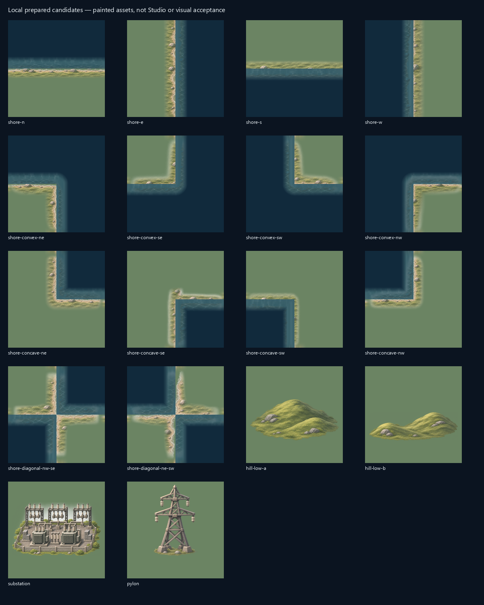
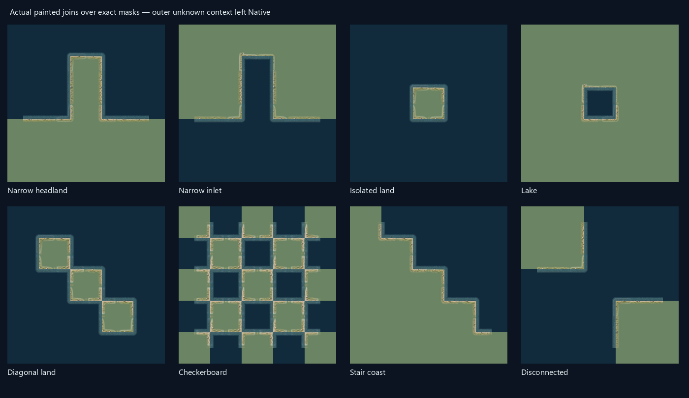
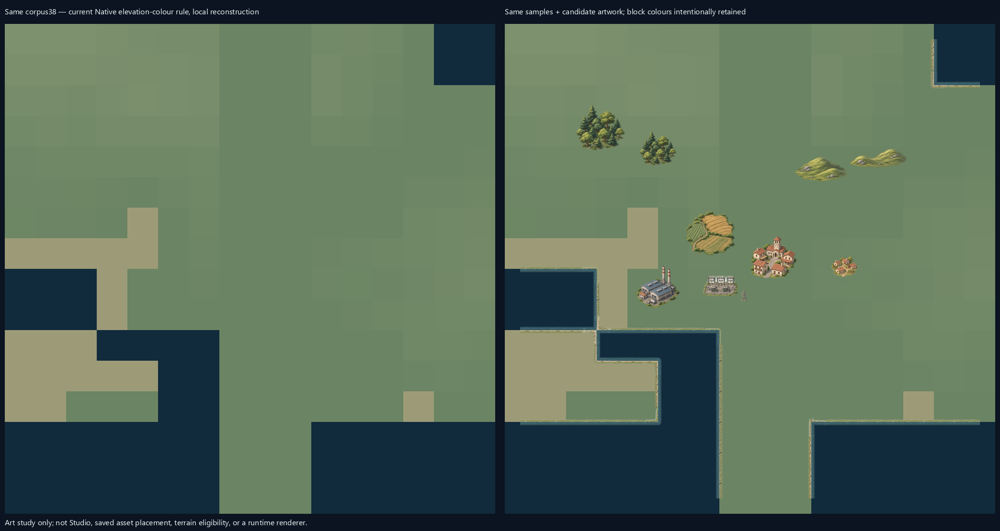
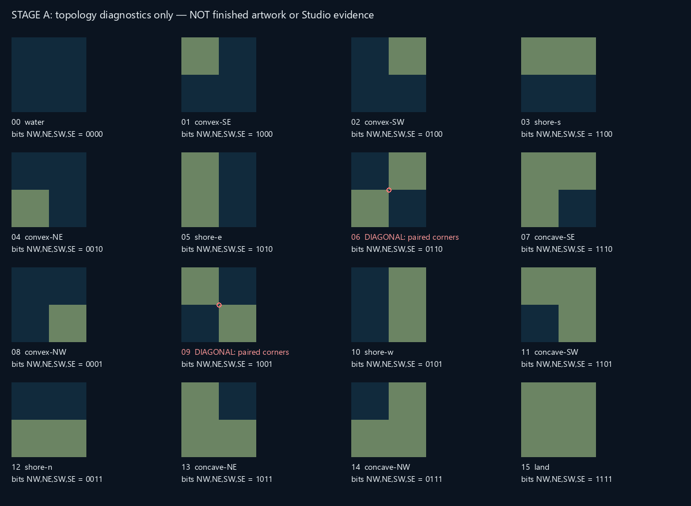
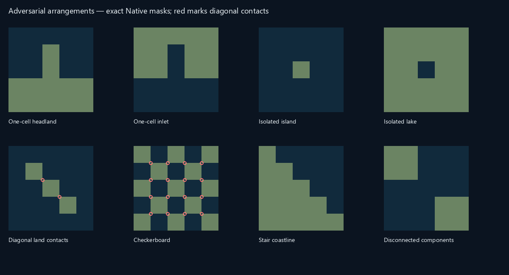
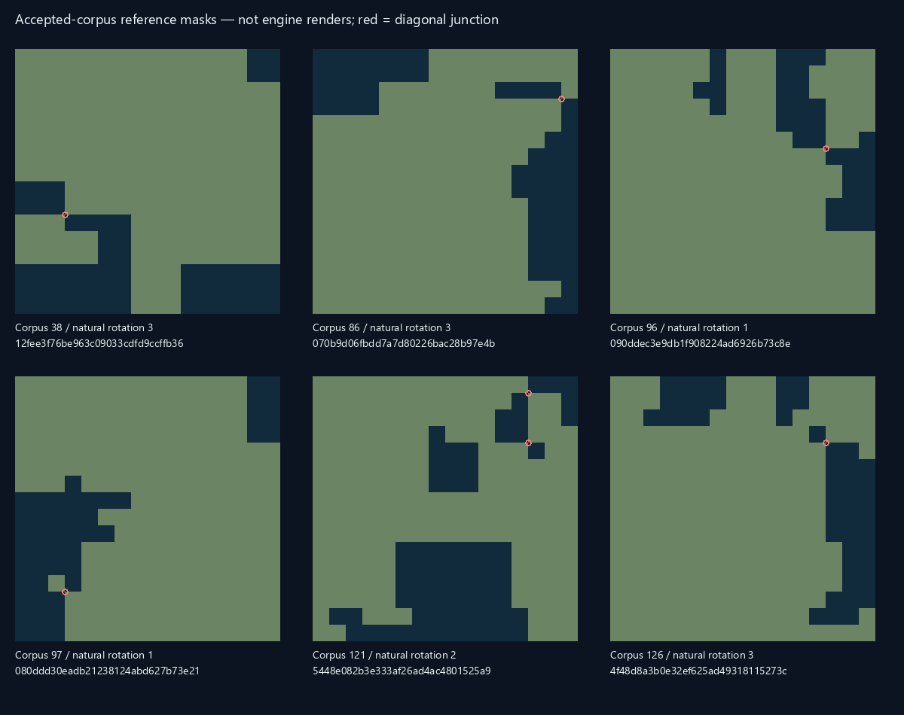
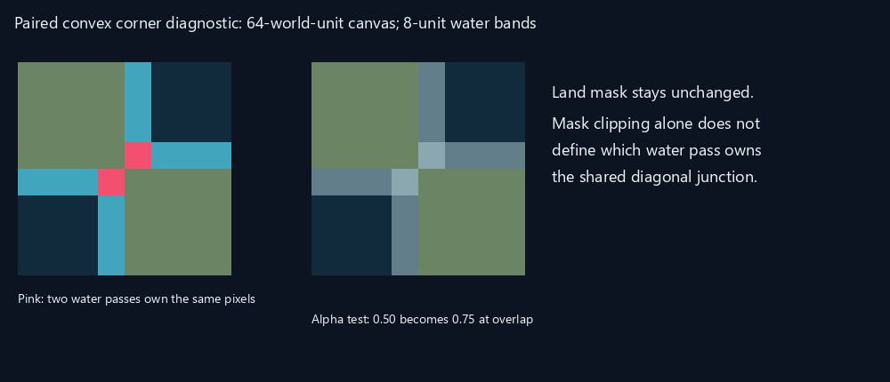

# Illustrated World v1 — amended eighteen-motif local art validation

Subsequent owner decision, 19 November 2026: all eighteen R1 motifs accepted for an **experimental Test proof**, and the owner uploaded both atlases. [Verified IDs, hashes and isolated renderer evidence](ILLUSTRATED-WORLD-V1-RENDERER-VALIDATION.md). This supersedes the local-art review stop below; final landscape/default adoption remains unapproved. The frozen artwork package remains unchanged.

19 November2026. **Owner-approved grammar amendment implemented; local artwork package produced for visual review. No upload or renderer integration.** Numerical compatibility passes; full illustrated-world visual acceptance is not claimed. The historical Stage A failure is retained below.

## Current deliverables

[Local package, inventory and preparation/provenance](../assets/illustrated-world-v1-art-r1/README.md) · [completed manifest](../assets/illustrated-world-v1-art-r1/manifest.json).

- 18 transparent240-square sprites:14 shores,2 hills,substation,pylon; approved1024-square main and512×256 companion atlases.
- 18 raw generated sources, exact prompts/hashes, geometry/material masks, reproducible preparation/validation scripts,16-layer/2-layer OpenRaster packing sources. Paint originals are flattened, not layered brush-stroke sources.
- All16 painted cases,128 edge contacts,90 motif/zoom samples,40 difficult-arrangement/zoom samples, six corpus composites, native-colour/flat-ground comparisons, pivots and enlarged diagonal centres.

| Packed PNG | Actual SHA-256 |
| --- | --- |
| [Main1024×1024](../assets/illustrated-world-v1-art-r1/power-state-terrain-edges-proof-v1.png) |`d8d3994469c68f31d800cadec9c8e3aeda3d25ecd3693c6140e781c402c5b0cb`|
| [Companion512×256](../assets/illustrated-world-v1-art-r1/power-state-diagonal-shores-proof-v1.png) |`e669e58a0b8b32d0f19f21025b79cc878eed134ed285ad4880353b6d580fd62f`|

Both earlier approved atlases/manifests remain unchanged. No invented Roblox IDs.

## Actual local validation

| Check | Result and scope |
| --- | --- |
| Amended grammar |All16 occupancy classes;14 direct mixed sprites;512 exhaustive3×3 arrangements /2,048 junctions. No paired-corner diagonals. |
| Golden reference/corpus |289 elevations match;10,000 approved seed definitions and40,000 all-orientation masks. Rotation distribution2482/2460/2589/2469 retained.731 countries contain780 diagonals; all covered. Independent Python reference, not new full Luau fairness/Studio testing. |
| Future slot observation |Natural shore junction p95=55, maximum78. Earlier64-shore-slot planning allocation cannot cover every country; future bounded fallback/allocation review required. No budget/runtime changed. |
| Pixel/packing |**579 assertions passed:** dimensions, bounds, nonoverlap, gutters, pivots, checksums, visible packed pixels,128 edge pairs,14 material masks/composited occupancy, exclusive footprints, diagonal alpha,90 resize samples and frozen atlas hashes. |
| Source joins |Zero alpha and premultiplied-RGB edge delta across128 compatible directed pairs. Exact categorical ownership at source resolution; one diagonal water pass, alpha<=185, no stacked corners. |
| Editable package |OpenRaster16+2 layer counts, ZIP structure and embedded merged-PNG equality checked. No paint-application/brush-layer claim. |
| Retained audit/isolation |77 asset checks; R33/R34/R35/R37 local83/14/4/27 passed (128 total). |
| Rojo/static |Both builds and Validate.ps1 passed: source/security/strict mapping and Git whitespace. Existing LF/CRLF notices only. |
| Engine/device |Not run: no new runtime, upload, real texture readiness, GPU/frame performance, physical controls or new Studio Script Analysis evidence. |

[Grammar results](../assets/illustrated-world-v1-art-r1/grammar-results.json) · [pixel results](../assets/illustrated-world-v1-art-r1/validation-results.json) · [package results](../assets/illustrated-world-v1-art-r1/review-package-results.json).

Corpus classification plus exhaustive local port proof establishes sampled grammar coverage; it does not mean10,000 painted countries were visually inspected. Six representative diagonal countries and explicit adversarial arrangements were composited. Source edge equality does not establish derivative continuity, perceptual seams, Roblox atlas filtering, mips or subpixel rounding. No invented acceptance threshold is used to claim otherwise.

## Preparation findings and remaining visual limits

Raw diagonal paint rounded the shared point and could visually bridge land. Exact ownership clipping corrected that without moving the Native mask. Two preparation methods were rejected visually: nearest-colour extrusion created streaks/bright patches; simple clipping alone left dark water trenches. The final pass retains valid original paint, clips wrong-side land, fills rejected water from a retained painted north-up shallow-water sample and blends ports in premultiplied alpha before straight-alpha export. No motif was rotated/mirrored. Raw sources and rejected previews are retained; intermediate numerical passes did not imply visual acceptance.

Ports match, but texture/highlight variation remains along some shores and corners. Their exact orthogonal shape is visible, especially in checkerboards and at1.8x. Unknown sector context remains Native. This contract does not make the country silhouette organically curved.

This is a labelled local reconstruction of the existing elevation-colour rule, not Studio. Existing gas/town/village/forest/field sources are unchanged. Study placements do not alter real nodes or imply authoritative land use. Large Native green/tan blocks remain; the flat-ground comparison separately shows style compatibility.

Hills/forest/fields share an illustrated family, but grass footprints remain visible on plain ground. Substation equipment reads as an electrical yard, with reduced detail at44px. Pylon art is about13 painted pixels high in its18px minimum-zoom canvas; native lines/markers/44px controls remain essential. All18 motifs and difficult joins have local five-zoom sheets in the package. Pillow samples are not Roblox/device acceptance.

**Smallest additional ground requirement for review:** one subdued neutral repeatable temperate-ground texture plus a controlled meadow/coast-colour transition treatment. Preserve the categorical land mask and geography. Texture alone cannot remove Native colour steps; any cosmetic blending policy needs separate review. No new ground asset, renderer rule or large library was added. This batch supports review of the motif direction; the reference-quality landscape goal is not complete.

## Provenance, memory and next boundary

Eighteen successful built-in image_gen.imagegen outputs, retained raw RGBA files and prompts; actual model/version not exposed. Existing approved art supplied as style reference/reused in labelled composites. No external stock download, guessed licence, exclusive-rights or legal-certification claim. Owner suitability/rights review remains relevant. Installed Pillow/NumPy only; no dependency installation.

New atlas base levels total4.5MiB RGBA; with existing atlases9MiB, approximately12MiB with full mips. These are arithmetic estimates, not Roblox memory/GPU measurements.

Review the actual artwork and limitations before any upload. After separate acceptance/authorization, the owner uploads exact accepted PNGs under missawfulname149564436, Restricted, for Test10776833313 and supplies verified Image IDs. Future Test implementation must preserve Native/default/fallback,600 descendants, exact anchors, native overlays/controls, bounded loading/culling/remounts and descriptor authority. Resolve the64-slot-versus78-junction observation before implementation; do not automatically increase budgets. Actual filtering, matched-camera, performance and device checks remain necessary.

Changed: new `assets/illustrated-world-v1-art-r1/` package; this report; PLANS; DECISIONS; current-status notes in the original audit and GUI specifications. Historical diagnostic/handoff packages, approved art, runtime/test Luau, geography, saved infrastructure and gameplay remain untouched. No real DataStore, Production, upload, settings, commit/push/publish/deploy action. **Stop at local artwork review.**

---

# Historical Stage A — twelve-shore grammar failure

19 November 2026. **Stage A stopped for grammar amendment; polished artwork not produced.** Owner authorization covers local production only, conditional on shoreline compatibility. No runtime or approved-atlas changes.

## Confirmed problem

The proposed twelve shore pieces cover four straight, four convex and four concave vertex patterns. A2×2 neighbourhood has16 occupancy patterns: two homogeneous patterns need no shore art, leaving14 mixed patterns. The remaining two have diagonal land pairs (NW+SE or NE+SW). They occur in the actual accepted corpus; they are not merely theoretical adversarial shapes.

Two convex pieces can represent the underlying boundaries, but the proposed clip-to-Native-land/water rule does not specify ownership of their overlapping water bands. In a controlled240-square diagnostic of the approved64-world-unit footprint and8-unit rim, **1,800 water pixels overlap**. Two ordinary source-over alpha0.5 strips produce alpha0.75 at the junction, a25-percentage-point opacity seam. The categorical Native mask remains unchanged. This is an explicit counterexample to a seam guarantee under generic mask clipping, not a measured failure of painted artwork that does not yet exist.

**My prior handoff overstated the completeness of the twelve-piece vocabulary.** It omitted the diagonal composition contract. Twelve source images are not mathematically incapable of forming a correct result: specialized material masks or a blend-aware compositor could resolve ownership. Those rules were not specified/proved by the approved handoff, and simple duplication or opaque overpainting cannot be accepted as seam validation. The Stage A acceptance gate therefore has not passed.

The user's explicit instruction governs: “If the12 proposed coastline sprites cannot cover the necessary arrangements through the proposed clipping/composition rules, stop and recommend an amended atlas grammar before producing polished artwork.” Production was stopped at this point; no geometric diagnostic is presented as finished art.

## Actual local evidence

| Check | Result |
| --- | --- |
| Independent integer reference |All289 stored P2bGolden active-sector elevations match; repeated reconstruction matches |
| Exhaustive local arrangements |All512 binary3×3 masks inspected, comprising2,048 interior junctions and all16 vertex classes |
| Approved seed corpus |Exact10,000 seed-a/b/c/d FNV-derived seeds from P2bWorld.spec; candidate0, matching historical zero-fallback corpus |
| Natural starter rotations |0:2482;1:2460;2:2589;3:2469, matching prior engine distribution |
| Actual diagonal incidence |731 countries (7.31%);780 junctions:374 NE+SW and406 NW+SE |
| Additional orientation diagnostics |All four reservation orientations for every seed:40,000 masks;3,087 diagonal junctions (1,481/1,606) |
| First counterexample |Corpus38, seed`12fee3f76be963c09033cdfd9ccffb36`, natural rotation3, world junction(192,640), NE+SW land |
| Narrow shapes/components |Explicit narrow headland/inlet, isolated island/lake, staircase, checkerboard and disconnected-component diagrams |
| Zoom diagnostics |0.55,0.72,1.0,1.2,1.8 categorical occupancy previews; not painted-art sampling tests |
| Preservation |Both approved atlas SHA-256 values reverified; retained77 audit checks passed |
| Existing isolation |R33/R34/R35/R37:83/14/4/27 passed,128 total |
| Build/static |Both Rojo builds, strict/source-security and Git whitespace checks passed; only LF/CRLF normalization notices |

The reproducer intentionally exits2 because the acceptance gate remains false; local diagnostic generation completes successfully. Repeated sweeps reproduced the same counts.

The corpus sweep is an independent Python reference using the existing exact integer hash/Q12 implementation and starter reservation formula. It is not a newly executed full Luau generation/fairness suite or a Studio render. It reconstructs all17×17 elevation samples and classifies cells exactly as GeneratedTerrain: land iff the northwest sample is above zero. No bilinear coastline or altered generator is substituted. All-four-orientation cases are extra diagnostics, not newly approved player countries.

Only interior15×15 junctions are counted. An owned-sector edge is a clipping boundary, not proof of ocean outside; missing neighbour data must never invent a coast. Existing world-generation, electrical topology, coordinates and approved climate rules remain unchanged.

[Machine-readable results](../assets/illustrated-world-v1-grammar/grammar-results.json) · [reproducer and package](../assets/illustrated-world-v1-grammar/README.md).

## Genuine diagnostic contact sheets

These images are generated from categorical masks and controlled alpha strips, not image-generation art, manipulated Studio screenshots or Westhaven substitutes.

[Five zoom levels](../assets/illustrated-world-v1-grammar/five-zoom-mask-check.png). The current Native Studio baseline remains in the [previous audit](ILLUSTRATED-WORLD-V1-VALIDATION.md); there is no new illustrated after-render to compare. These diagrams preserve its categorical silhouette rather than make it look less blocky.

## Recommended amendment — not implemented

Add **two diagonal-junction motifs**: `shore-diagonal-nw-se` and `shore-diagonal-ne-sw`. Their land quadrants preserve the Native four-connected components and exact shared point; no smoothing into a bridge and no carving an artificial channel. Each motif is separately painted with north-up orientation, the same upper-left light and short lower-right shadows. Outer boundary colour/alpha profiles must meet the corresponding straight/corner ports. Author the centre once, eliminating duplicated corner passes there.

This makes14 shoreline motifs plus two hills/substation/pylon: **18 motifs total**. Preserve the original1024×1024 main atlas and sixteen256×256 allocations. Proposed companion atlas: **512×256**, two256-square cells,8px gutters,240-square content, pivots(120,120),64-square world canvases. No shrinking, replacing or silently dropping the four non-shore assets. [Exact unapproved layout](../assets/illustrated-world-v1-grammar/amendment-proposal.json).

Alternative: keep16 motifs and validate a new exclusive material-mask/compositing protocol for paired corners. That may avoid another texture, but introduces mask/clip complexity and potential pool cost. It needs a separate local compatibility proof; ordinary overlapping ImageLabels are not equivalent to a custom blend operator. I recommend the two direct junction motifs for simpler future bounded rendering.

The companion image adds0.5MiB raw RGBA base storage, approximately0.667MiB with a full mip chain. New main+companion base storage is4.5MiB; including the two existing approved atlases totals9MiB (about12MiB with full mip chains). These are arithmetic estimates, not Roblox texture memory/GPU measurements. A future adapter must bound all approved atlas fetches; the existing two-atlas proof cannot simply assume a fourth texture is already supported.

The amendment does not grant an increased GUI budget. One authored junction sprite can replace a paired-corner composition slot. Pool/culling/performance must still be tested against600 map descendants after integration approval. No runtime code is written here.

## Production inventory and provenance status

| Deliverable | Status |
| --- | --- |
| Original16 polished sprites |Not produced: Stage A gate failed before Stage B |
| Main packed PNG / completed artwork manifest |Not produced; approved packing template retained unchanged |
| Editable illustration sources / art prompts |None generated; no image-generation call made before grammar acceptance |
| Diagnostic source |Local Python script, existing integer reference and Pillow; reproducible, no external service/dependency installation |
| Diagnostic hashes |[Actual package hashes](../assets/illustrated-world-v1-grammar/package-hashes.json); these are not final artwork checksums |
| Existing gas/town/forest/field reuse |Unchanged approved sources; joint artistic composites deferred until terrain grammar passes |
| Edge colour/alpha halos, pivots, minimum-size artwork readability |Not evaluated on finished artwork; diagnostics do not establish acceptance |
| Shared ground treatment |No extra ground asset requested or produced; need cannot be assessed from unpainted masks alone |

Approved1024-square atlas remains SHA-256`e1dcb61948e575bab85d94a6eed3dce1939fe87389455fc3bce735a28cab63cb`; approved512×256 settlement atlas remains`baff92a631e89bbf9a1506f5401488e40fc2d5fe56a71399b1f410df5b05ff4e`. Their frozen manifests are unchanged. No new Roblox IDs, invented file hashes or finished-art provenance are recorded.

## Next action and boundaries

Review the proposed two-motif/companion-atlas amendment, or choose a twelve-shore-sprite compositing investigation. After that gate passes, produce the coherent illustrated batch using the approved existing motifs as references, then validate pixel ports/halos/pivots and all five zooms on the actual corpus masks before owner visual review.

There is **nothing ready to upload**. Future accepted files need exact final hashes, provenance and local comparisons; owner uploads manually under missawfulname149564436, Restricted, for Test10776833313 and supplies verified Image IDs. No upload, permissions, Production10776828545, real profile, gameplay, runtime integration, publish/deploy/commit/push action occurred.

Changed files: this report; roadmap/decision register; a follow-up note in the previous audit; new `assets/illustrated-world-v1-grammar/` diagnostic script, five PNG sheets, result/proposal/isolation JSON, README and package hashes. Existing Luau runtime/test code and approved art remain intact. Stop at Stage A; do not label the local art-production sprint complete.
