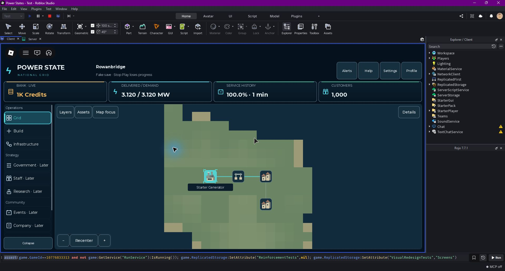

# Illustrated World v1 — audit and prototype validation

**Art-production follow-up (current):** owner approved the two-diagonal/companion-atlas amendment. All18 local candidates and painted compatibility evidence now exist; source pixel checks pass, owner visual acceptance and remaining ground quality are separate. [Current artwork report](ILLUSTRATED-WORLD-V1-ART-VALIDATION.md). This original audit remains historical; no renderer integration/upload authorized.

19 November 2026. Visual Redesign v1.1 accepted by owner. Test/fake storage only; Native default, no real records, uploads or Production changes.

## Stage A — audit before renderer implementation

The Grid concept and both approved atlases were visually inspected. Current Grid evidence is [v1.1](evidence/visual-redesign-v11/grid-desktop.png). The concept has continuous painted relief, coherent coast transitions, roads and dense inhabited regions. Current generated Native uses 256 elevation-coloured 64-unit cells and separate genuine infrastructure overlays. Colour changes alone cannot close this gap.

| Existing asset | Verified local file / image | Reuse decision |
| --- | --- | --- |
| Six-motif revision 3 | `assets/r32-proof-v3/power-state-map-proof-v3.png`; SHA-256 `e1dcb61948e575bab85d94a6eed3dce1939fe87389455fc3bce735a28cab63cb`; Image 86222383311104 (Decal 105986918888502) | Retain frozen atlas; town, gas, forest and fields are reusable. Local checksum reverified. Historical approval/provenance in R34 supersedes pending fields in frozen manifest. |
| Settlement revision 1 | `assets/r37-settlements-v1/power-state-settlements-proof-v1.png`; SHA-256 `baff92a631e89bbf9a1506f5401488e40fc2d5fe56a71399b1f410df5b05ff4e`; Image 90608851718773 (Decal 138420314032574) | Rural village usable as a cosmetic district treatment. Coastal settlement needs a compatible coastal site, not every generated district. Local checksum reverified. |
| West headland | Rect 8,8,496,496; old world 248-square, origin 93.5,238.5 | Not a procedural edge tile. Opaque backing explicitly fitted to `x=350-sqrt(175^2-(y-365)^2)` and two tangents. Retain old proof; do not stamp into arbitrary coastlines. |
| Snowy mountain ridge | Rect 520,8,496,240 | Retain for future compatible climate/elevation. Protected temperate starter and modest sampled elevations do not justify arbitrary snowy peaks. |
| Forest / fields | Rects 520,264 and 776,264, each 240-square | Organic isolated motifs, not seamless terrain tiles. Potential bounded cosmetic vegetation/field texture on fully dry compatible footprints; never declare resources or extra customers. |
| Newford / gas | Rects 8,520 and 264,520, each 240-square | Reanchor cosmetic ground pivot to actual server nodes; keep upper-left lighting, no rotation/mirroring and no movement of electrical anchors. |
| Southbank / Eastmere | Rects 8,8 and 264,8, each 240-square | Southbank supports rural versus town silhouettes; no population-growth rules. Eastmere's baked coastal features require matching geography. |
| Substation / pylons / wind | Native silhouettes only | Retain actual native controls/topology. No approved illustrated substation, pylon or wind atlas exists. No invented wind farm in starter country. |
| R3.6 transitions | Local concept previews only | Artistic direction approval is not runtime-asset approval. Do not integrate or upload. |

Both approved atlas files and their source manifests remain frozen. Existing R3/R31 native, R33 synthetic, R34 real and R35/R37 layered experiments remain intact. Old 1200×800 fixed anchors cannot be copied into the live 1024-square sector. Old 595-descendant fixture cannot be duplicated per sector.

The current server descriptor contains 17×17 samples of elevation, mean temperature and rainfall, country/seed and pinned versions. It does not contain authoritative roads, rivers, agricultural land-use or forest-cover records. Native currently treats each cell by its northwest sample. Preserve that silhouette rather than moving coastline to fit artwork. Only owned sector zero is replicated; do not draw undiscovered sectors from a client-generated seed.

Existing image loading uses ContentProvider on actual ImageLabels, bounded five-second readiness, late-callback cancellation and native warm-underlay. R34/R37 real measurements are historical, not this sprint's results. Restricted asset IDs were previously verified to owner149564436/Test10776833313; new load failure must not trigger permission changes. Estimated raw RGBA base levels: 4MiB plus0.5MiB, about6MiB including a full mip chain; Roblox allocation/GPU performance must be measured separately, and cached Studio GraphicsTexture cannot isolate these atlases.

## Proposed bounded architecture

Keep all experimental modules in the Test mapping. Adapt server descriptors to immutable cosmetic placements; separate imagery from terrain authority. One fixed pool, no allocation on pan/zoom; shared existing camera UIScale, conservative whole-footprint land eligibility, independent native lines/markers/labels/selection. Native always remains underneath. A failed image never removes targets or suppresses authoritative overlays. Explicit Test-only mode selection; no normal default change.

The first existing-art proof can improve settlement/generator recognition and vegetation texture. It cannot deliver the concept's continuous illustrated shoreline/hills with the present atlas. A new terrain-edge batch is required for that quality goal. Do not describe this limited proof as reference parity or as a finished illustrated world.

## Gate outcome — stop before Stage C

**Stage A audit and Stage B/E design handoff complete. Stage C/D renderer implementation has not started.** The request explicitly says to stop for owner review when “the result cannot use existing assets well enough to reach the proposed visual prototype.” That gate applies to the landscape requirement: the only approved coast fits a fixed authored curve, while no reusable coast-edge, temperate-hill, substation or pylon images exist. Town/gas/forest stamps can improve recognition, but would leave the large sampled blocks and unsupported shoreline transitions that this sprint explicitly asks to move beyond. This is a visual-coverage/design gate, not a claim that Roblox cannot render the assets or that the600 budget has failed.

No new renderer, loader, gameplay code, default-mode switch, art pixel revision or GUI change was made. No new runtime performance result, generated-country after screenshot or owner acceptance is claimed. The allowed stop was taken before producing a misleading partial “illustrated world”. New local artwork production could use the existing workflow, but the missing edge contract should be reviewed at this explicit gate before investing in the batch.

## Stage B — coherent world illustration system

Use the approved elevated2.5D style, north up, upper-left lighting, short lower-right shadows, muted sage/ochre/stone and quiet water. Flat coordinates remain canonical. Do not rotate/mirror raster motifs to fit starter rotations; reanchor their ground pivots while preserving lighting. Cosmetic vegetation variation is deterministic from versioned presentation keys and compatible supplied climate/elevation. Never call the authoritative generator on the client or scatter randomly per frame.

Treat existing1,000-resident town and durably connected250-resident district as the only two settlement treatments: existing Newford town versus Southbank village. These are cosmetic illustrations of already supported records, not new population thresholds. The surveyed unbuilt pad remains a preview and must not gain occupied-house art, electricity demand or revenue. Original old-fixture anchors remain frozen; new placement descriptors use each real terminal plus a bounded cosmetic offset, with connection points never altered. Future city art reuses the same stable terminal/identity/slot contract; growth is not implemented.

Keep generator gas art, native substation and native connection overlays recognizable. A new pylon may decorate only actual line segments, not line crossings; no junction is implied unless a genuine graph node exists. Wind artwork is absent and wind construction remains excluded; existing Operations technology glyphs are not an illustrated wind-farm asset. Roads, rivers, ports and extra inhabited areas are omitted where world data does not represent them. Field texture may eventually be cosmetic, but must not advertise authoritative agricultural activity absent from the descriptor.

Future cold/dry/wet variants share footprints, pivots, edge probes and diffuse boundary bands. Select/blend their appearance from supplied continuous fields without changing temperature, rainfall or world versions. Snowy ridge is withheld from the guaranteed temperate starter, not deleted from the approved library. No new climate/resource system is proposed here.

## Concrete future Test adapter plan — unimplemented

1. `IllustratedSectorDescriptor` reads owned-sector samples and actual nodes/lines, validates widths/versions/finite coordinates, and prepares deterministic bounded cosmetic records. It cannot alter the input or create gameplay IDs. Key placements by country identity, generation version, sector, cosmetic revision and semantic feature; stable sort/explicit tie breaks, no table-order dependence.
2. `IllustratedAtlasCatalog` references frozen approved source rectangles and separately versioned new-art records after approval. Do not expand the old R33 frozen validator to accept arbitrary caller rectangles. Check atlas bounds, gutters, pivots, aspect ratio, allowed URI and overhang.
3. `IllustratedSectorRenderer` owns a candidate fixed96-image pool shared by shore/decorative/infrastructure artwork (planning allocation64/24/8, not96 per category or sector). Reuse existing terrain root/UIScale/camera transform. Retain the entire native fallback; never allocate during pan/zoom. Coalesce only compatible boundary runs; if the pool cannot cover them, retain Native for those regions rather than dropping land or drawing invented edges. Profile that mixed result before acceptance.
4. Initial arithmetic from the existing394-descendant generated map leaves206 descendants.96 image slots + up to3 containers/scales +12 badge descendants + up to8 mode-control descendants would total513, leaving87. This is an estimate, not an engine result; actual remounts, built topology, enlarged text and alternate modes must assert<=600 before activation. The old595-descendant authored proof is not this base and cannot receive this pool.
5. `IllustratedAtlasSession` reuses the proven actual-ImageLabel preload/readiness protocol. Maximum one attempt per approved atlas per mount, five-second deadline, no main-thread wait, cancellation tokens, native warming underlay, late callback rejection and cleanup. Explicit remount retries only. Cache-unknown load times are labelled accordingly; denied/moderated synthetic cases are not real access evidence.
6. Test-only accessible Native/Illustrated selector uses the existing action/focus registry and44px targets. Initial mode Native; preserve camera, selection, inspector and Layers state. Hide proposed-district house imagery until the existing authoritative construction state is durably built. Do not infer connection state from painted roads or wires.
7. Keep everything experimental outside the Production Rojo mapping. Actual graph lines, labels, hit targets, selection and controls stay native above decoration. Clip cosmetic shore/ground sides to the unchanged Native land mask; do not interpolate a different gameplay coastline or conceal terrain changes in the renderer.

## Stage E — smallest art production handoff

[Production brief](../assets/illustrated-world-v1-handoff/README.md) and [packing/pivot template](../assets/illustrated-world-v1-handoff/proposed-manifest.json). One proposed1024-square atlas: four straight coasts, four convex corners, four concave corners, two snow-free hill clusters, a substation and a pylon. Reuse both existing approved atlases for forest/fields/gas/town/village. No PNG or upload-ready asset was generated; the proposed filename/hash fields are explicitly incomplete. The new template is not a runtime manifest and contains no Roblox ID.

The brief defines perspective, lighting, palette, gutters, scale, source naming/provenance, pivots, edge compatibility, expected memory and owner-only upload steps. First review local edge composites against actual generated boundaries and both land/water colours. Then the owner may upload an accepted exact/checksummed file; no automatic upload or permission change is proposed. This is the recommended next art milestone, not an instruction to implement subsequent gameplay.

## Actual validation in this task

| Check | Actual result |
| --- | --- |
| Existing atlas SHA-256 | Both exact approved hashes match; no pixel changes |
| Local audit script |77 assertions passed: source/export/correction hashes, RGBA/dimensions, rectangles/nonoverlap, pivots, transparent gutters, proposed16-slot packing and no invented asset ID/hash |
| Retained R33/R34/R35/R37 local isolation |83/14/4/27 passed (128 total); approved URI and module exclusion from Production builds preserved |
| Both Rojo builds/source-security/strict/whitespace |Passed using `scripts/Validate.ps1`; only Git LF/CRLF notices |
| New renderer/real texture readiness/CPU/frame/texture memory |Not run: no new renderer exists at this gate |
|10,000-seed/all rotations, simulation/Bank/construction/reconnect, engine GUI/focus/device regressions |Not rerun in this audit-only outcome; v1.1 results are historical baseline evidence, not new acceptance |
| Full-project Script Analysis |Not rerun; v1.1 captured0/0 is historical. No Luau files changed in this task |

[77-check audit record](illustrated-world-v1-audit-results.json); [128-check isolation record](illustrated-world-v1-isolation-results.json). Local validation reads approved asset bytes without rewriting their manifests or pixels. The new Python audit uses the already-installed Pillow used by existing art validators; no dependency installation.

## Visual comparison and honest evidence limits

| Reference, not runtime artwork | Last accepted actual Native baseline (v1.1) |
| --- | --- |
|  |  |

The right image is the prior v1.1 actual Studio capture at1612×735 safe root, retained unedited. It was inspected for this audit but is not a fresh Illustrated World capture. Concept country/seed/camera differ; this table is an art-gap comparison, not a matched benchmark. No after image, different-seed illustrated screenshot or constructed-district illustration is fabricated. R34/R37 screenshot evidence remains historical fixed-fixture rendering, not procedural integration.

Before accepting a new prototype, capture same-session same-seed/camera/viewport Native versus Illustrated, a second approved fixture seed, all four rotations, selected generator, actual fake purchased district, desktop1612×735, tablet1024×540, portrait390×580 and short landscape844×390. Record exact camera/seed, image readiness, current state and whether scenes are live fake gameplay or explicit fixtures. Test realistic zooms0.55/0.72/1/1.2/1.8, all layer toggles, mouse pan, Locate/Recenter, keyboard focus and existing gamepad paths. Physical input remains a separate requirement.

Measure initial/cache-unknown and warm load, fixed-camera matched redraw p50/p95, frame p50/p95/worst, descendant counts before/during/after remount, whole-client GraphicsTexture with attribution limits, eight simulated country descriptors and repeated resize/movement. Keep historical performance gates; do not infer low-end performance from desktop Studio. Retain the full10,000-seed route/fairness and solver/accounting/security/fake purchase/restore regressions. No real profile testing belongs in this milestone.

## Changed files and remaining decision

Created: this report, `scripts/ValidateIllustratedWorldAudit.py`, two audit-result JSON files and the handoff README/proposed manifest. Updated: PLANS, DECISIONS and the three GUI design specifications to record the scoped audit/art gate. Existing runtime, test Luau, atlases, source manifests, coordinates and generation/simulation versions remain unchanged.

**Owner review requested:** review the proposed edge grammar/minimum art batch and the recommendation to complete it before the procedural renderer prototype. Alternatively, explicitly accept a narrower buildings/vegetation-only interim proof with unchanged block coastlines. That alternative is not the requested finished illustrated sector and has not been silently substituted. No new default renderer, upload, Production or gameplay action is authorized by this report.

