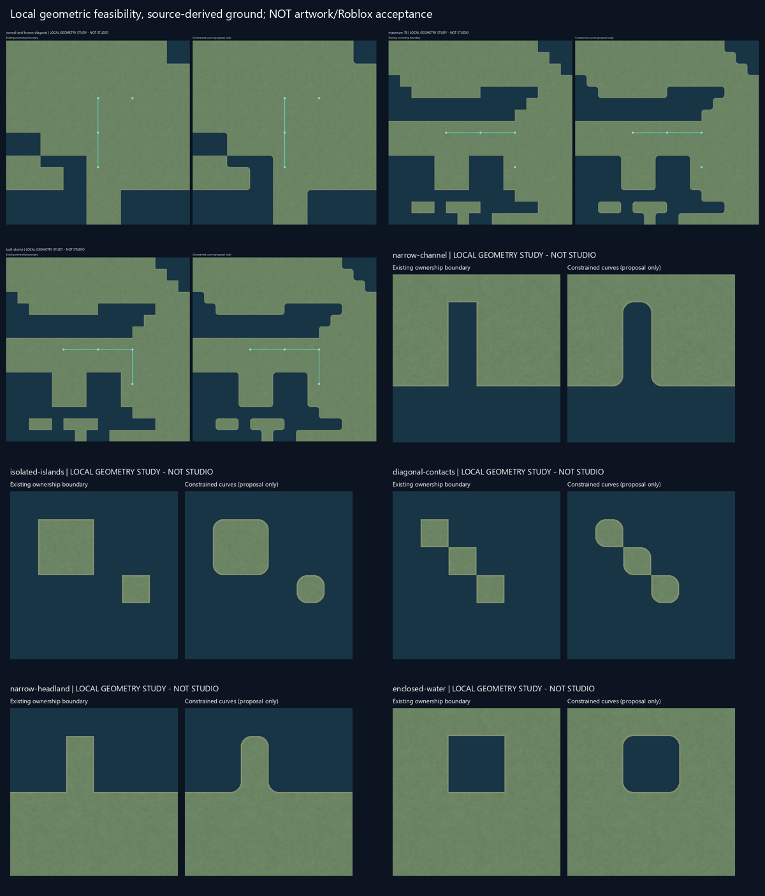

# Illustrated World v1.3 — ocean continuity and coastline review

20 November 2026. **Completed available Test validation and local design study; stopped for owner review. Organic geometry is not integrated or approved; long-frame root cause remains unresolved.** Owner accepts Ground + Ocean as the preferred experimental appearance, not the normal Test/Production default. Native remains initial/default and fallback. No real DataStore, Rowanbridge, Production, settings, upload or publishing operation is part of this work.

## Ocean boundary correction

The v1.2c shader varies ocean RGB with interpolated elevation and the approved ground material's quiet grain, but the viewport outside the known 1024-square sector is RGB(24,53,70). Those different values expose the finite rectangle. This is a colour discontinuity, not a hole in shared screen-edge coverage.

`OceanBoundary` applies a cubic smoothstep weight to **water colours only**. Let d=min(x,y,1024-x,1024-y), t=clamp(d/64,0,1), w=t²(3-2t). Multiply the existing shallow-water colour offset and grain by w. At the boundary and gutters the result is exactly the viewport deep colour; beyond one known cell from the edge the old ocean formula is unchanged. Both ends have zero first derivative. No adjacent terrain is synthesized, no water ownership is assigned, and land pixels are untouched. This is a presentation fade into unknown background, not bathymetry or proof that adjacent sectors contain sea. Land reaching the unknown boundary still ends there; this task does not pretend it is a complete island.

The shoulder uses the existing four 514-square EditableImages and 256 slots. Cosmetic cache colour revision advances to2; authoritative versions do not change. No extra GUI instance, image, material, or runtime animation is introduced. A potential visible dark shoulder near edge-adjacent shores remains a visual review item: matching the endpoint mathematically alone does not establish an attractive blend.

## Coastline design: findings and alternatives

The original Grid inspiration was inspected. It has long coherent curves, relief and shoreline materials rather than orthogonal ownership cells. The current approved terrain is different: each rendered 64-square cell uses its **NW sample's sign**, while terrain validation uses its own approved sampling rules. A continuous zero-elevation contour is therefore not an interchangeable representation of the existing cell mask.

The local bilinear zero-contour comparison changes76,892 pixels in the normal fixture and137,102 in the maximum fixture (one pixel/world unit). Normal water components change4→3; maximum water components3→4 under four-neighbour connectivity. **Reject direct contour replacement.** Smoothing interpolated elevation more aggressively or adding noise does not repair this ownership conflict. No such contour was installed in Roblox.

Recommended bounded next proof, **requiring owner approval**: preserve the categorical component graph and use elevation only to choose a small cosmetic corner radius. The local candidate rounds isolated one-land/three-land interior corners with a circular fillet, radius16–24 world units (`16 + min(8,floor(abs(savedElevation)/15))`). The synthetic stress cases use24. At two-land diagonal saddles retain the exact point and existing separate quadrants; never choose a new diagonal bridge or channel. Straight ports are fixed; no noise, RNG or new generation version is involved. This is an incremental safer alternative, not reference parity or a claim that all staircase character disappears.

| Method considered | Finding |
| --- | --- |
| Continuous elevation-zero contour | Smoothest immediate shape, but fails categorical connectivity comparison; rejected as a drop-in replacement. |
| Unconstrained spline/blur or procedural jitter | Can overshoot, close passages or move component contacts; requires explicit topology/corridor projection and separate proof. No noise added. |
| Small topology-preserving corner fillets | Explicit displacement bound, local ports and simple rejection rules; prototype supplied. Remaining stair segments limit visual quality. |
| Exact ownership plus relief/colour ribbon | Zero geometric deviation; safest alternative if any visible ownership displacement is unacceptable. Does not eliminate the square boundary. |

An initial8–12-unit local exploration was too subtle at map scale; the supplied final feasibility comparisons use16–24. Neither size is a runtime approval. The larger candidate still changes only a small area and leaves straight stair segments. If the owner wants substantially more natural curves, a separately reviewed model of cosmetic intertidal space or a new gameplay-geography representation is necessary. Do not silently enlarge this displacement allowance.

### Geometry and safety contract proposed

- Source is the immutable saved descriptor; local hashes and seeds are recorded in `geometry-validation.json`. Identity, samples, climate, ownership, electrical network and construction rules never change.
- Geometry lives in the minority corner's radius-square. Maximum analytic boundary Hausdorff displacement is24(√2−1)=**9.942 world units** (rounded up); the conservative changed-region bound is24 units from its vertex. Raster changed-pixel distances are separate measurements, not a substitute for the analytic bound. At the proposed one-output-pixel/world-unit resolution, reserve an additional at-most1-unit raster/filter fringe: a conservative final visible bound is **10.942 units**, subject to actual filtering tests. An antialiasing/material ribbon exceeding that bound requires separate review.
- Corner patches do not overlap:2r≤48<64. Preserve cell centres and side-centre connections, a16-unit central corridor, and every diagonal saddle. Test both four- and eight-neighbour component correspondence for land **and** water, not just a total component count. Small islands and narrow channels may round at their ends but cannot vanish, merge or acquire a new connection.
- Freeze corners within80 units of an infrastructure anchor. Local tests require the complete ±32-unit square around each existing/surveyed district anchor to remain identical. Future implementation must also protect exact surveyed route/pad and visible occupied-art footprints, with conservative whole-native fallback where exclusions overlap. Never move an asset to make an illustration fit. A cosmetic land patch is not a buildable site.
- Do not round at unknown sector borders. Future adjacent descriptors need a shared world-coordinate boundary contract and agreement on both sides before changing border presentation. World-aligned texture phase and shared gutters remain mandatory. Never extrapolate missing neighbouring samples as ocean.
- Do not map a curved coast to a false construction affordance. Existing fixed-project preview and electrical anchors stay authoritative and visible above the surface; arbitrary future placement must show the true eligibility overlay. If this cannot be communicated clearly, retain the exact categorical coast and soften only colour/relief (zero geometric deviation).

### Local evidence and limitations

`scripts/StudyOrganicCoast.py` is reproducible local raster/geometry tooling using already installed numpy/Pillow/scipy. No dependency was installed. It uses two actual previously exported Test descriptors: normal/known diagonal seed`12fee3f76be963c09033cdfd9ccffb36` and maximum78 seed`fe0512aa351b994df1656b88f0d94f1b`. The built-district panel protects the latter descriptor's actual surveyed district anchor; it does **not** read a real built profile or execute a purchase. Additional narrow-channel, isolated-island, diagonal, headland and enclosed-water fixtures are explicitly synthetic adversarial masks.

All512 exhaustive3×3 masks and eight local cases preserve component counts and one-to-one component mappings, outer borders and protected anchor squares at one-world-unit raster resolution. The three actual-descriptor cases also preserve all three existing/surveyed route corridors with16-unit margins; the built panel shows the third connection without moving its endpoints. Actual normal/max candidates change427/2,147 pixels, rounding7/37 corners respectively. The built case matches the maximum geometry because cosmetic status must not move its anchor. Local diagrams use source-derived existing material and schematic shore tint, not finished new coastline artwork or Roblox screenshots.

[Exact measurements and case provenance](evidence/illustrated-world-v13/geometry-validation.json) · [Normal before/after](evidence/illustrated-world-v13/normal-and-known-diagonal-comparison.png) · [Maximum78](evidence/illustrated-world-v13/maximum-78-comparison.png) · [Built district](evidence/illustrated-world-v13/built-district-comparison.png) · [Rejected direct contour](evidence/illustrated-world-v13/normal-and-known-diagonal-rejected-contour.png) · [Diagonal close-up](evidence/illustrated-world-v13/diagonal-detail.png).

### Proposed integration and art contract, not implemented

1. Add a separately versioned **cosmetic** mask builder in the Test tree, deriving bounded corner records from the saved descriptor. Validate topology, port equality, unknown borders and exclusions before rasterizing. Fall back for the entire affected presentation on failure; no authority changes.
2. Rasterize land/sea coverage plus a constrained shoreline material ribbon into the existing four padded chunks. Reuse world texture phase and shared-edge placement. Keep native lines, markers, labels, hit targets, focus and inspector unchanged.
3. The current14 categorical shore sprites are not curvature-independent. Leaving them unchanged would paint angular rock/water over the new curve; clipping alone may amputate cliffs. A future material study must replace/reuse those shore slots or bake compatible shoreline relief into the same chunks. Do not layer a second full shore library or add labels. Existing building/hill motifs remain separate and must pass visible-footprint exclusions.
4. Maximum225 interior junction records; ≤256 terrain slots and existing96 illustrative slots; **600 total map descendants remains hard**. Four output RGBA payloads stay4,227,136 bytes. A temporary1024² byte mask would add1MiB CPU payload, or row-wise evaluation can avoid it; the latter is recommended before any resource increase. These are estimates, not measured Luau/GPU costs. Retain source+staging memory bounds, one image update per frame,20-second preparation limit, timeout/allocation failure fallback and cleanup.
   Use cell-indexed corner records, not a scan of225 corners for every output pixel. The disjoint corner squares occupy at most225×24²=129,600 pixels; a row buffer and fixed local lookup can compose them into the existing staging image. Preparation must remain cancellable and measured against the unchanged deadline. No mask/image work should occur during pan or zoom.
5. Require exact neighbouring gutter values, all five zooms plus fractional offsets, diagonal filtering/halo checks, protected site visibility, fresh actual texture readiness, cancellation/remount and long-run/device profiling before adoption. A local image is not runtime acceptance.

## Frame-stall investigation

Historical242.556/270.778ms records remain unchanged in the v1.2c evidence. New bounded Test telemetry records up to72,000 frame samples and64 >50ms events, with mode, ground readiness, last synchronous transition duration/age, descendant count, Lua heap and whole-client memory. It does not force GC or change Studio profiler/settings. A memory drop alone is not proof of GC causation; RenderStepped duration is not a GPU trace. Actual findings follow.

Fresh mixed-mode run08:42–08:52UTC:600.881s/591 cycles,35,871 frames,470 descendants, p50/p95/worst16.640/17.677/**278.653ms**. Whole-client memory2484.41→2350.82MiB; Lua heap4852→6115KiB. A fully retained267.056ms event occurred at92.130s, Ground/Ready,470 descendants,628.778ms after a4.878ms transition. Another56.706ms event occurred619.199ms after a4.975ms transition. No source synthesis, image creation, pixel write or disposal occurs in this steady loop; those operations finished before measurement. This excludes those synchronous calls as the direct work measured at the first event, **not** deferred GPU work, GC or other activity as possible causes.

Studio truncated the combined event JSON at1,024 characters, losing later event details. The complete soak summary and first two events are preserved; the278.653ms worst event cannot be correlated retrospectively. The diagnostic now prints each bounded event separately. This is a logging correction, not a performance fix, and the first truncated run is not relabelled as complete event evidence.

A separate180.003s idle Native control (no ground adapter attached,362 descendants) recorded10,627 frames, p50/p95/worst16.641/17.721/**158.873ms**,41 events >50ms, whole-client2256.53→2253.26MiB. It ran as a command-bar task and had an idle rather than moving camera, so it is **not a matched causal experiment**. It demonstrates spikes can also occur without the ground adapter, but does not exonerate it or explain the278ms spike. Its unused `workAgeMs` has no meaning because no transition was recorded; later diagnostic code uses−1 for this case. [Native control and all41 events](evidence/illustrated-world-v13/native-control.json).

No renderer defect causing these long stalls is established; no speculative GC/Studio attribution or gameplay/timing change was made. CPU sampling, total memory and `gcinfo()` cannot identify a GC pause or GPU queue stall. A focused MicroProfiler capture around the event, preferably on a standalone permitted Test client and physical devices, remains the recommended next investigation. No profiling/settings change or publication was performed here. Native must remain default; this sprint does not certify hitch-free play.

## Actual ocean screenshots and visual limits

All new JPEGs are unedited Studio captures of fake exported Test fixtures. The fixture named Rowanbridge is `illustrated-fixture-2`, not the real persisted country. No real profile was accessed. Normal Native/Illustrated/Ocean use the same1366×704 safe root and0.55 camera. High-zoom capture uses1.8 and Locate(64,640); maximum78/built uses0.72; portrait uses360×560. These are desktop Studio layout observations, not physical-device acceptance.

| Comparison | Evidence |
| --- | --- |
| Historical v1.2c ocean, before correction | [Original capture, retained unchanged](evidence/illustrated-world-v12c/normal-ocean-desktop.jpg) |
| Corrected ocean at0.55 | [Actual Studio](evidence/illustrated-world-v13/ocean-normal-055.jpg) |
| Matching Native | [Actual Studio](evidence/illustrated-world-v13/native-normal-055.jpg) |
| Matching original Illustrated | [Actual Studio](evidence/illustrated-world-v13/illustrated-normal-055.jpg) |
| Maximum78/built at0.72 | [Actual Studio](evidence/illustrated-world-v13/ocean-max78-built-072.jpg) |
| Sector-edge/diagonal close view1.8 | [Actual Studio](evidence/illustrated-world-v13/ocean-edge-180.jpg) |
| Portrait safe root | [Actual Studio](evidence/illustrated-world-v13/ocean-portrait.jpg) |

The abrupt finite-water rectangle is replaced by a soft offshore shoulder in these views. Land at unknown edges still clips, as required. The close view exposes existing rectangular shore-art endings and colour/relief mismatch; these are not fixed by offshore colour blending. Shores remain angular and natural-curve integration is not claimed. The broader sea can look dark near edge-adjacent inlets; owner review is still needed. No new islands/channels, water animation or neighbouring sectors were invented.

## Validation and completion status

Final engine rerun at09:10–09:12UTC passes39,727 Ground/Ocean assertions and3,128 retained Illustrated checks, including real approved-image readiness, all supported/fractional zooms, responsive roots, shared edges/crops, unchanged descriptors,44px targets, selection/camera preservation and cleanup. Nil-source/nil-chunk/late-callback/timeout cases are explicitly synthetic. Four images and470/600 descendants remain bounded. The first run and fresh600-second mixed-mode soak are retained separately.

Both Rojo builds, source/security/disabled-real-service checks, Git whitespace and99 static isolation checks pass. Full-project Script Analysis is0 errors/0 warnings with the current-script filter off ([capture](evidence/illustrated-world-v13/script-analysis.jpg)). Independent10,000-seed/four-rotation grammar passes9,000,000 junctions in25.581s, max78 natural/80 all rotations. Existing Studio social/chat403 and unrelated203785492 asset-type warnings remain unrelated diagnostics, not substituted terrain resources. A new documentation trailing-blank-line check failure was corrected and the build/check rerun passed; no acceptance rule changed.

## Retained regression evidence

Final preparation measurements: source306–490ms, accumulated synchronous work676–692ms, four pixel-write submissions0.332–0.362ms total, binding/wait98–100ms, elapsed10.057–10.075s. Preparation frame p95 17.41–17.72ms, worst19.75–23.06ms in that final run; earlier capture preparations reached39.18ms and are retained in the raw records. Clearing256 bindings and destroying four retained images took0.712–1.009ms across three final cleanup calls. These timings measure API/synchronous work, not GPU completion, exact physical memory reclamation or cold-CDN latency. Source/cache state was not flushed.

| Final180-frame matched camera path | Draw CPU p50 / p95 / worst ms | Frame p50 / p95 / worst ms | Map descendants |
| --- | --- | --- | --- |
| Native |0.101 /0.121 /0.154|16.643 /17.699 /18.447|362|
| Original Illustrated |0.756 /1.026 /1.468|16.662 /17.365 /17.779|470|
| Ground |1.320 /1.583 /2.580|16.616 /17.310 /17.709|470|
| Ocean |1.319 /1.561 /2.209|16.609 /17.389 /17.776|470|

GraphicsTexture telemetry remained40.699MiB for all modes and does not isolate EditableImage cost. Whole-client memory was1886–1893MiB during the final short comparison, versus2471–2479MiB earlier; process/cache history differs, so this is not a measured memory optimization. [All benchmarks](evidence/illustrated-world-v13/benchmarks.json), [preparation](evidence/illustrated-world-v13/preparation.json), [cleanup](evidence/illustrated-world-v13/release.json), [long run](evidence/illustrated-world-v13/endurance.json) and [raw timestamped output](evidence/illustrated-world-v13/studio-current.txt) retain both favorable and unfavorable evidence.

Fresh retained server session09:03–09:04UTC completed Operations Atomic326, Security231, Scenario3,144, Fleet Lifecycle2,062, Reinforcement Model497, Transaction61, Economy20,179 and Resources2,065 checks. Scheduling passed63 eight-country intervals under native/30Hz/15Hz inputs without weakening deadlines or limits.

Separate09:05–09:09UTC retained sequence completed P2a432, P3c94/safety31, First Playable controls42, P2b accounting2,941, P3a fake178, P3b93, fake migration44, gameplay33, bounded-economy50 and scheduler49 assertions. P3c accounting completed1,440 billed intervals with12 exact restores. The actual Luau10,000-start/four-rotation route/pad/fairness sweep passed2,916,780 assertions. Client tests passed remote transport12, normal construction journey34, Bank83, GUI364, currency16, interaction135, map190, framing52, synthetic hybrid739 and real-atlas focus/presentation241. The entire retained runner reported completion.

These are fresh fake-storage/actual-engine results, not real-service guarantees. The four legacy600-second R34/R37/Native/P2b soaks from v1.2c were retained unchanged rather than rerun; the new mixed-mode600-second run specifically exercises the changed ground/ocean path. Physical touch/gamepad/device acceptance, isolated GPU memory and long-stall root cause remain open. No all-tests-ever or hardware acceptance claim is made.

## File inventory and review boundary

New: `OceanBoundary.luau` (Test water-colour shoulder), `FrameInvestigation.luau` (bounded Test timing evidence), `scripts/StudyOrganicCoast.py` (local feasibility only), this report and `docs/evidence/illustrated-world-v13/`.

Updated: Test `ContinuousGround.luau` (colour revision2 and synchronous release timing), `ContinuousGround.spec.luau` (4,230 additional colour checks and opt-in timing observation), `scripts/ValidateIllustratedRenderer.py` (explicit production exclusion), `PLANS.md` and `docs/DECISIONS.md`. All earlier uncommitted v1.2b/v1.2c source and evidence were preserved. This sprint changes no production runtime module, test-project defaults, input controller, authoritative generator, solver, economy, construction, persistence, atlas or saved descriptor.

## Decisions before organic renderer work

Owner review must choose: (1) accept the bounded16–24 radius/≤9.942-unit geometric displacement proof (≤10.942 including the proposed1-unit raster fringe) versus exact-mask colour-only treatment; (2) accept exact diagonal/unknown-border preservation even where visibly angular; (3) approve a separate shoreline material/slot-reuse proof before replacing categorical artwork; (4) approve any extra temporary mask memory only if row-wise reuse proves insufficient. No new geometry, art upload, resource ceiling increase or default adoption is inferred from this document. Stop at that review gate after the authorized existing-contract validation.

At09:13:53UTC, Test10776833313/creator149564436/authenticated Studio149564436 were reverified in stopped edit mode. Task runners/capture attributes were cleared; only `IllustratedWorldProof=true`, `ContinuousGroundProof=true`, `RunRegressionTests=false` remained. Rojo remains available on34873. For owner inspection, start Test Play and use Layers → Geography to cycle Native/Illustrated/Ground/Ocean. Initial mode remains Native. No settings change, real storage, Rowanbridge mutation, Production operation, artwork upload, commit, push, publish or deployment occurred. Stop here for visual/design review; do not automatically implement the coastline proposal.
