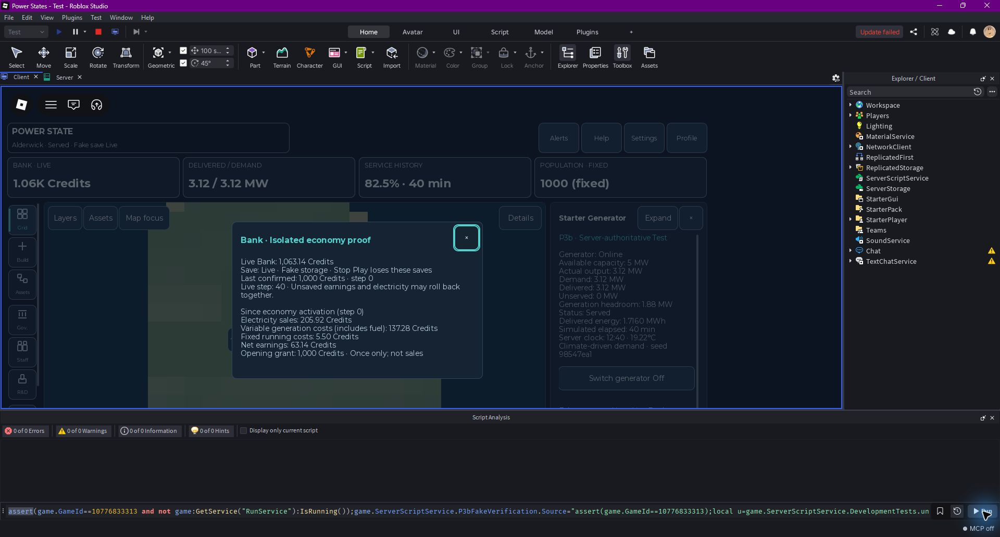

# P3b implementation and fake-storage validation

**P3b.5 bounded real economy proof complete (18 November 2026):** exactly five intervals across two authenticated Test sessions; seven updates/five uncached reads. Rowanbridge Bank1,007.66 Credits, step118, generator On, profile revision24/country revision131/epoch7/no lease. Both economy execution gates closed afterward; ordinary real startup remains disabled. [Actual results and remaining boundaries](P3B5-VALIDATION.md). Earlier statuses below are historical.

**P3b.4 preparation and available validation complete (18 November 2026):** added a disabled, exact-Test/account existing-schema-v2 economy path and fake validation; no real DataStore calls or migration. See [guarded integration and proposed execution](P3B4-VALIDATION.md). Separate real execution approval remains required. Earlier statuses below are historical.

**18 November 2026 — P3b.3 real migration/release complete:** see [P3B3-VALIDATION.md](P3B3-VALIDATION.md) for the guarded implementation, 315 fake assertions, 439 static checks, successful fresh preflight and five actual service calls. Rowanbridge is schema2, Bank1,000 Credits, profile revision17, country revision124, epoch5, no lease, unchanged step113/history. No economic gameplay or financial checkpoints occurred; subsequent real testing requires separate approval. Earlier no-write statements below describe their historical tasks.

**18 November 2026 — P3b.2 read-only readiness passed:** one fresh uncached read of the approved Test key, exact local migration preview, protected preimage and recovery plan are recorded in [P3B2-READINESS.md](P3B2-READINESS.md). The real head remains v1/revision15, Bank0; no write or lease operation occurred. P3a/P3b fake suites passed 178/93 assertions and both builds passed. Real-v2 code enablement and execution remain separately gated. Historical P3b/P3b.1 task statements below retain their original scope.

17 November 2026. **P3b.1 focused timing correction and required regressions complete. The earlier Bank GUI gate is resolved by the documented authoritative progression test.** D113 authorizes implementation/fake tests; no real schema-v2 writes or migration are authorized. Production was not accessed or modified. No DataStore calls, uploads, permissions/settings changes, publishing, commits or pushes occurred in this task.

## P3b.1 investigation update — 17 November 2026

Owner authorized the focused investigation/correction in D117. **Focused regression validation passed**; the historical failed-gate evidence below remains intact. No real DataStore access or migration occurred.

The original unchanged 1.2-second assertion passed one fresh sequenced session, then failed in the next at 20:50:19 UTC. The earlier first attempt had a harness startup race: it began while the normal P2b client was still mounting, producing two shells and failing cleanup before the Bank test. Sequencing the temporary harness after `PowerStateShell` startup removed that setup conflict; no runtime bootstrap was changed.

Confirmed Bank failure cause: **the test inferred authoritative progression from a wall-clock sleep across two independently phased schedules**. Simulation settles every accumulated second; periodic publication uses its own one-second `lastSend` clock. A successful Sync can deliver newer state between periodic publications. The following periodic publication may still contain that same step, so a 1.2-second observation need not see a higher step. No Bank menu pause, lost settlement or ordering rejection is evidenced in the failing trace.

[Bounded before trace](P3B1-TRACE-BEFORE.json), captured in fresh Play, records the final subscription at UTC ms 1794948617638, first receipt step27/rev38/103827 minor, initial LiveViewModel mount at 1794948618172, then receipt/acceptance of step28/rev39/104018 at 1794948618213. LiveViewModel creates the initial Bank metric; subsequent snapshots update the KPI and open Bank through SimulationClient's presenter, not through a second LiveViewModel creation.

Relative to test start **1794948618383** (expected next step29 and revision40):

| Relative time | Observed event |
| --- | --- |
| −469 ms | Server settled step28/rev39; Bank104018 |
| −203 ms | Sync published step28/rev39 |
| −170 ms | Client received and accepted step28/rev39 |
| 0 ms | Bank opened and test recorded step28/rev39/104018 |
| +330 ms | Periodic publication still step28/rev39; next settlement not due yet |
| +363/364 ms | Client accepted that same snapshot and rendered the open Bank |
| +531 ms | Server settled step29/rev40; Bank104210 |
| +1213 ms | Old assertion observed client step28/rev39 and failed |
| +1747 ms | Next recorded publication step30/rev41; Bank104401 |

The trace dump happened after the 1.2-second observation and can perturb later frames; do not treat the later publication gap as an uninstrumented latency benchmark. The pre-failure sequence already establishes that settlement advanced and the assertion preceded the next periodic publication. Instrumentation is opt-in Studio/Test only, capped at 128 scalar records per context, and adds no yields, gameplay clock changes, remotes or private persistence fields. One initial bulk log was truncated by Studio; the retained evidence uses one small record per line.

**Explicit acceptance-policy correction (D118):** the default test now waits for the same session to reach both `initialStep+1` and `initialRevision+1`, with a **3-second liveness deadline**. This accommodates the two independent one-second schedules plus delivery/frame allowance, and matches the existing client stale-data window. It does not change scheduler cadence, prices, financial formulas or that stale-data window. Three seconds is not a desired update latency. Each layout separately logs actual elapsed latency, initial/expected/observed step and revision, and whether the unchanged 1.2-second reference was exceeded. The original assertion remains callable through `legacyTiming=true`; it was not deleted or relabelled as passed.

The corrected test also verifies the financial settlement cursor, a Bank increase for funded served operation, exact rendered overview text, KPI parity, and preservation of camera/selection. Repeated calls can run just Bank cases after the full interaction/security suite. Final results and limits follow.

### Final P3b.1 results

[Regression measurements](P3B1-MEASUREMENTS.json) and [after trace](P3B1-TRACE-AFTER.json) preserve the actual evidence.

- **Six corrected Bank runs passed**, three traced and three untraced in two fresh Play sessions. Each passed **83 assertions**; **24** authoritative progression observations across 1366×704, 360×580, 640×300 and 768×960 safe roots. Each repeated run remounted and cleaned up its client. No corrected deadline failure occurred.
- Progression waits: **0.2471–0.9649 seconds**, median **0.7975 seconds**, zero above the 1.2-second reference in these corrected runs. This is a different set of schedule phases, **not evidence of improved runtime latency**: no scheduler was changed. The original-mode reproduction still demonstrates why the old inference was invalid.
- In the retained traced run, 19 receipt records matched by step/revision to the latest preceding server publication showed **22–48 ms** (median33) publication-to-receipt elapsed time. Twelve open-Bank presenter updates followed receipt by **1–2 ms**. These are same-host diagnostic timestamps and text-assignment timings, not GPU display latency or physical-device measurements. No ordering rejection appeared in the retained trace.
- **P3b pure/fake: 93 assertions passed again**, covering full-day totals, fractional carries, On/Off/disconnected/capacity-limited billing, funding, migration idempotence, ambiguous writes, reconnect and stale-owner rejection. Prices and financial formulas were not modified.
- **P3a fake unit: 178 passed**. Separate fresh-session P3a client regression passed **88 interaction + 32 actual remote + 15 presentation/privacy** assertions, with zero Bank preserved.
- **P2a:** 432 unit, 57 GUI and 32 actual remote assertions passed. **P2b:** 2,941 accounting, 88 GUI and 32 actual remote assertions passed; full 10,000-seed world sweep passed **2,916,780 assertions**, 10,000 unique starts and zero fallbacks. Eight-job generation scheduling and **49 P2b.1 scheduler assertions** passed. Existing generation/arithmetic source hashes remain unchanged.
- P3b generated interaction/remote checks passed **88 + 32**. Shared shell/currency units passed **324 + 26**; GUI layout/currency/navigation passed **348 + 16 + 135**.
- Both Rojo builds passed; local source/isolation checks passed **34 + 38 + 159 + 149 = 380**. Git whitespace passed. Final Studio Script Analysis showed **zero errors/warnings**, current-script filter disabled.
- Play stopped; temporary local proof runners disabled, normal client runner restored, tracing disabled. No real adapter executed. No uploads, settings, Production, commits, pushes or publishing.

Actual [desktop Bank](p3b1-screenshots/desktop-bank.jpg), [phone-size Bank](p3b1-screenshots/phone-bank.jpg), and [Script Analysis](p3b1-screenshots/script-analysis.jpg) captures are available. Phone capture uses a 360×580 safe root in desktop Studio; it is not a physical phone test. The existing scrollable stacked-detail design remains unchanged, including the previously disclosed difference from a dedicated desktop category table.

### P3b.1 files changed

- Added `src/shared/Util/SnapshotTrace.luau`: opt-in, Studio/Test-guarded 128-record diagnostic buffer; no remote or persistent identity fields.
- `src/server/Services/PersistentTestService.luau`: diagnostic hooks at intent handling, completed settlement and publication; scheduling, billing and storage behavior unchanged.
- `src/client/Simulation/SimulationClient.luau`: diagnostic hooks for subscription, receipt/ordering, initial view-model mount and Bank text presentation. No change to snapshot acceptance or Bank formatting.
- `tests/integration/P3b.spec.luau`: authoritative step/revision wait, exact displayed-data checks, explicit latency reporting, repeat-only mode and retained original reproduction mode.
- `docs/P3B-VALIDATION.md`, `docs/DECISIONS.md`, `PLANS.md`, `README.md`: scope/results/status. Added `P3B1-TRACE-BEFORE.json`, `P3B1-TRACE-AFTER.json`, `P3B1-MEASUREMENTS.json` and three screenshots. No economy, schema, solver, climate, artwork or LiveViewModel implementation change in P3b.1.

### Repeat the focused proof

Use only the connected **Power States - Test** place. Temporarily disable the normal `StarterPlayerScripts.DevelopmentTests.Run` client runner before Play so suites do not compete for one GUI. Start fresh Play and wait for the normal shell to finish mounting. In the **server** Command Bar invoke `require(game.ServerScriptService.Server.Services.PersistentTestService).startEconomy()` (always fake). In the **client** Command Bar run:

```lua
local player = game.Players.LocalPlayer
local live = require(player.PlayerScripts.DevelopmentTests["P3b.spec"])(player.PlayerGui)
-- Run again with bankOnly=true after live.destroy() for just the focused cases.
-- The third argument legacyTiming=true retains the original 1.2-second reproduction assertion.
```

The explicit full call includes generic GUI and remote-security checks before Bank checks. For tracing only, set `ReplicatedStorage` attribute `P3bSnapshotTrace=true` on the Test server before the run; tracing is normally absent/off. Re-enable the normal runner after stopping Play. Do not start `startReal`, run `P3aReal.spec`, or enable schema2 writes.

### Remaining migration boundary

The timing blocker is resolved. This focused task does not freshly verify Rowanbridge's current real head, capture a reviewed preimage, authorize financial writes or prove real-service migration. Before proceeding: complete the exact-account/universe/key uncached preflight, review the current-head migration diff and preimage/checksum/recovery plan, then obtain separate owner approval. The real adapter remains v1-only. Earlier broader review items (worst-case financial size/adversarial review beyond current fixtures, physical-device acceptance and economic multi-client/endurance evidence) are not claimed completed by this timing correction. No public-release readiness is implied; mandatory non-Robux insolvency recovery remains deferred.

## Historical stop gate (resolved by P3b.1 above)

At **20:35:26 UTC**, `tests/integration/P3b.spec.luau` failed **“Bank does not pause simulation”** on its first desktop Bank overview check. The test waited 1.2 seconds for a newer client snapshot. The later inspected screen showed the open Bank at step 40 and 1,063.14 Credits; shortly before stopping, the visible state reached step 90 with a confirmed step-64 checkpoint. This demonstrates later progress, but does not turn the failed timing assertion into a pass. Possible snapshot scheduling/arrival timing remains a hypothesis, not an established diagnosis.

Per the owner's instruction to stop on a required validation failure, no threshold was weakened and no subsequent acceptance work was attempted. Play was stopped. Temporary local `P3bFakeVerification` and `P3bFakeClientVerification` scripts were disabled; the normal `DevelopmentTests.Run` client runner was re-enabled. These temporary scripts are not in either Rojo mapping and were not published. Resume only with owner direction to investigate this gate. Do not request or execute real migration yet.

Remaining: diagnose the timing failure using server and client observations; finish Bank-specific tablet/mobile/status/cleanup checks; capture mobile screens; rerun relevant unchanged GUI and P3a client regressions; complete additional financial adversarial/size/queue tests and final source review. No physical-device or economic multi-client acceptance is claimed. Desktop Bank currently uses the existing scrollable stacked-detail panel rather than a dedicated desktop category table; this visual difference remains for review.

## Implementation present

- Pure server billing at the approved 120/80/10 rates, 100,000-minor opening grant, 25,000-minor usable buffer, exact category carries over 60,000 and at most 24 completed statements plus a partial hour.
- Separate economic-country wrapper clones candidate state so solver/billing failure does not partially mutate the input; it reserves gross operating costs, forces unaffordable operation Off, rejects unfunded restart and has no automatic bailout or restart.
- Separate schema2 validator, pure v1-to-v2 transformation and fenced lease wrapper. Existing v1 validators/lease/country/migration modules remain byte-identical. Legacy physical history is retained with activation baselines and no historical billing.
- Dependency-injected fenced coordinator, restricted to fake storage for schema2. Existing real adapter now validates every write candidate with the unchanged v1 validator; it cannot write a v2 financial profile.
- Explicit `PersistentTestService.startEconomy()` selects fake storage only. Normal bootstraps and Native rendering remain unchanged. Owner snapshots expose bounded finances and confirmed balance/step, excluding migration operation and lease identities.
- Bank KPI and scrollable overview present live/confirmed funds, sales, variable/fixed costs, net, grant, buffer guidance, hourly statements and storage/funding status. No entitlement lookup, Shop, spending or recovery mechanic.

Mandatory before public release: separately design and validate **non-Robux insolvency recovery**. Zero-balance dead-end is accepted solely for this isolated proof. Future 2× sales requires a separate net-profit/balance review; effective factor is exactly 1 here.

## Evidence actually obtained

[Captured log evidence](P3B-MEASUREMENTS.json). All runtime results below are from the isolated Test universe `10776833313` with fake persistence; no real-service conclusion follows.

| Check | Result |
| --- | --- |
| P3b pure/fake suite | **93 assertions passed**, including full day, carries, migration steps 0/113/1440/1441, Off/disconnected/capacity-limited billing, funding exhaustion, malformed finance, ambiguous migration/checkpoint/release, reconnect and stale fencing |
| Full-service day | Sales 905,495 minor; variable 603,663; fixed 24,000; net 277,832; Bank **377,832 minor / 3,778.32 Credits** |
| Remainders after day | Sales 48,000; variable 52,000; fixed 0, each over 60,000 of one minor unit |
| P3a fake regression | **178 assertions passed**, existing failure/coordinator fixtures retained |
| P2a unit / shell / currency | **432 / 324 / 26 assertions passed** |
| P2b accounting | **2,941 assertions passed** |
| P2b scheduler | Eight synthetic generation jobs passed, identical descriptors |
| P2b.1 scheduler | **49 assertions passed**, eight synthetic jobs; no new actual multi-client run |
| P2b world | **2,916,780 assertions passed**, full 10,000-seed sweep; 10,000 unique starts, zero fallbacks |
| P3b generic generated GUI | **88 assertions passed**, resize/pan/zoom/Locate/recenter/selection/44px targets; desktop, phone portrait/landscape and tablet safe-root sizes |
| P3b actual remote transport | **32 assertions passed**; malformed/replayed/stale/unauthorized/rate-limited commands |
| P3b Bank-specific GUI | **FAILED** at first desktop no-pause assertion; subsequent Bank-specific cases did not run |
| Local static checks | P2a 34, P2b 38, P3a 159, P3b 149 passed |
| Builds | Both Rojo builds passed; source mappings, guarded-service checks and Git whitespace passed |
| Studio Script Analysis | Zero errors and warnings with current-script filter disabled after implementation, observed before and after proof run |

An initial editor-mode attempt encountered a demand-input error. A fresh Play session passed the initial 75-assertion suite and the subsequent 93-assertion suite without that error. Editor require caching is a possible explanation; it was not established as the root cause. Only fresh Play results above are treated as test evidence.

## Measurements and limits

- Economy-only `Economy.settle`: **0.0301 ms p95**, 8,000 serial settlements, below the approved 0.25 ms target. This was a serial microbenchmark, **not eight concurrent players**, regardless of the initial log's “eight-country equivalent” wording; that label was corrected afterward.
- Whole candidate step: **0.414 ms p95** across the full day, including physical-history clone/validation. Different workload from economy-only timing.
- Full-history schema2 checkpoint: **89,670 bytes**, under 192/256 KiB soft/hard caps; the tested finance extension passed its 16 KiB assertion. Not an exhaustive worst-case identifier/size proof.
- Existing P3a canonical encode p95: **6.947 ms** in this run; separate from pure billing cost.
- Generated map remained **345 descendants** throughout the generic resize/interaction suite.

| Safe root | Map-pan CPU p50 / p95 | Frame p50 / p95 |
| --- | --- | --- |
| 1366×704 | 0.0926 / 0.1275 ms | 16.63 / 17.49 ms |
| 360×580 | 0.1197 / 0.1476 ms | 16.65 / 17.51 ms |
| 768×960 | 0.0942 / 0.1172 ms | 16.60 / 17.46 ms |

These are desktop Studio measurements at safe-root sizes, not low-end mobile evidence. No new ten-minute endurance or actual eight-player economic test was completed. No real DataStore latency or financial durability result is claimed.

## Sample screen



The screen was captured after the failed assertion while the open overview continued receiving snapshots. It is evidence of the rendered desktop state, not visual acceptance or a passed no-pause gate. Mobile Bank screenshots remain outstanding.

## Real migration proposal — not ready for approval

Intended future destination remains Test `10776833313`, personal owner `missawfulname` / `149564436`, standard store `PowerStateProfilesP3aTest`, default/global scope, exact key `u:149564436`. No new key or store is proposed.

The last **historical** real observation is schema1 Rowanbridge, country `55e35a88-e3b9-4f72-9e69-d9024e7730a4`, seed `1441a4d819354af7b306ef8797931e15`, profileRevision 15, sessionEpoch 4, no lease, On, step113, zero Bank. This task has **not freshly reverified it**. Do not use these historical values as an atomic expected preimage.

Conditional proposed diff if that head is still current after fresh verification:

- Preserve country identity, recipe/seed/versions, settlement, infrastructure/anchors, land/deltas, entire simulation including On state and history. Preserve requested `5.875999999999989` and delivered `5.355999999999993` MWh exactly.
- Set schema2, ledger2, economy/balance1; opening grant/balance 100,000 minor; earned/spent zero; usable buffer25,000; immutable grant ID `P3bOpeningV1:<countryId>`.
- Set activationStep and lastSettledStep113; exact old energy baselines; zero post-activation meters/categories/remainders/statements. First eligible interval113→114. No retroactive revenue or expense.
- Atomically increment profileRevision15→16, sessionEpoch4→5 and the freshly verified countryRevision by one; acquire a normal 180-second fenced lease and record one stable `MigrateAcquire` operation ID. Never invent the unverified countryRevision or a grant/migration receipt beforehand.

After all fake gates pass, obtain an uncached identity/revision read with verified Test/account context, then present the exact diff for separate approval. Proposed preimage workflow: record full validated head plus platform version/user-ID associations/metadata locally with checksum and capture time under that approval; re-read immediately before the first write and compare exact reviewed content/revision; stop if changed or actively leased. Migration callbacks must preserve metadata and contain no side effects. Current v1-only real adapter must remain closed to v2 until that separate authorized implementation/review.

Recovery is not an automatic rollback: preserve preimage and any committed v2 head, suspend on uncertainty, reconcile the same operation ID, never delete/reset/force-unlock/downgrade. Any recovery write requires separate review and must advance fencing/revisions while restoring a coherent whole financial/physical state. No preimage export, real migration, or real write was attempted here.

## Files changed in this implementation task

New runtime: `src/server/Domain/Economy.luau`, `EconomicCountry.luau`, `ProfileSchema2.luau`, `ProfileMigrations2.luau`, `ProfileLease2.luau`; `src/client/Simulation/BankPresentation.luau`.

Modified runtime: `src/server/Services/ProfileService.luau`, `PersistentTestService.luau`; `src/server/Adapters/DataStoreAdapter.luau`; `src/client/Simulation/SimulationClient.luau`, `LiveViewModel.luau`; `src/client/Views/FeedbackView.luau`.

New tests/checks: `tests/unit/P3b.spec.luau`, `tests/integration/P3b.spec.luau`, `scripts/ValidateP3b.py`. Existing `tests/integration/P2b.spec.luau` and `P2aRemote.spec.luau` now accept the explicit P3b profile while retaining previous cases.

Documentation/evidence: this report, `P3B-MEASUREMENTS.json`, desktop screenshot, `P3B-DECISION-PROPOSAL.md`, historical `P3B-DESIGN-VALIDATION.md` status/encoding correction, `DECISIONS.md`, `PLANS.md`, `README.md`. Other uncommitted files predate this task and were preserved.
