# Visual Redesign v1.1 — reference polish

19 November 2026. Implementation and available validation complete; owner visual acceptance pending. Fake-storage Test only. v1 is owner-accepted as a technical foundation.

## Stage A — comparison before implementation

All eight original Inspiration PNGs inspected directly, alongside the v1 actual Studio captures. Categories: **1** native GUI work authorized now; **2** new artwork requiring separate owner review/upload; **3** future gameplay, not authorized.

| Screen / concern | Reference versus v1 | Classification and action |
| --- | --- | --- |
| Shared header | Reference has a strong lightning/wordmark and a separate country/status zone; v1 combines a small brand and country inside one outlined box with a large empty middle | 1: separate fixed brand hierarchy from live identity on wide screens, keep compact safe-root composition and actual status. 2: photographic control-room banner. 3: fictional dates/flags are not imported |
| Navigation | Reference is a compact rail with clear symbols, grouping and bright selected row; v1 uses tall outlined buttons and muted small text, leaving lower routes below the fold | 1: compact 44px-minimum rows, consistent symbol treatment, lighter inactive borders and stronger active text; retain collapse, future labels and mobile bottom routes |
| KPIs | Reference uses large semantic icons and stronger label/value alignment; v1 has only thin accent lines | 1: native semantic symbols, consistent content inset and clear financial/service hierarchy; preserve actual Bank, demand, unmet and headroom values. 3: unavailable national statistics remain absent |
| Grid / inspector | Reference has a framed asset hero and structured facts; v1 has mostly prose and modest titles | 1: stronger selected-asset hierarchy, grouped facts and action priority without map-instance growth. 2: painted terrain and asset hero thumbnails. 3: maintenance/condition/history tabs |
| Build | Reference integrates catalogue, map and requirements; v1 has oversized repeated rows in a generic review | 1: investment masthead, project/category context, denser aligned cost/eligibility facts, clear fixed action area; retain genuine project/price/expiry/saving. 2: project thumbnail. 3: storage/generation catalogue, placement modes and build timers |
| Infrastructure | Reference separates asset identity/output/status from selected detail; v1 uses multiline buttons and text detail | 1: bounded native asset symbols, separated name/status rows and selected output bar; preserve actual filters, controls and Locate. 2: asset thumbnails. 3: staff, condition, maintenance, upgrades |
| Operations | No separate supplied Operations image; use Infrastructure output/status hierarchy. v1 repeats national prose above generic cards | 1: technology-specific native identity, compact live summary, actual/available production bars and clearer control hierarchy. Preserve all detailed costs and forecast through existing detail actions |
| Bank | Reference gold financial emphasis contrasts with v1's large repeated boxes | 1: compact section/key/value rhythm, aligned totals and stronger primary amounts; narrow layouts remain stacked and scrollable |
| Government / Staff / Shops / Ticker | Rich cards, identities, tab groups and banners in concepts; no matching live systems | 2: future local illustration package; 3: remain documented future systems. No invented news, employees, policies, entitlements or purchase controls |

Native surfaces use restrained navy/teal depth, cyan active selection and amber financial emphasis. No glow stacks, external dependencies, uploads, static-image interfaces or terrain replacement. Existing focus outlines, hover feedback, 44px controls and bounded pools remain requirements. Live values must not trigger structural remounts or geometry changes.

## Implementation, validation and evidence

Actual Studio evidence and retained regressions are recorded below. Physical touch/controller acceptance remains outstanding.

## Implemented files and behavior

Client-only changes in this sprint:

- `Views/HeaderView`: separate wide wordmark/caption and live country identity, compact fallback within unchanged safe-root height.
- `Views/NavigationView`: expanded 44px minimum rail rows, stronger labels/active state and quieter inactive borders; collapsed and mobile navigation preserved.
- `Views/NavigationIcon`: native semantic KPI/technology symbols, optional theme colour.
- `Views/KpiStripView`: width-aware symbol inset with no lost value width on narrow cards.
- `Views/Components`: medium-weight Test button typography; existing hover/focus behavior retained.
- `Views/DetailRows`: denser aligned financial rows, measured long values and stacked narrow layout; full message/overflow preserved.
- `Views/ProjectCategories`: investment caption and clearer completed-review close wording; no quote/action semantics changed.
- `Views/InspectorView`: stronger asset title/category and primary Locate action.
- `Simulation/InfrastructureDirectory`: separate asset name/status, native symbol, accessible full label and actual generator output/capacity bar; original four slots reused.
- `Simulation/OperationsView`: technology-specific card accents/symbols, fixed output-bar region, clear primary controls and compact national summary.
- `Simulation/OperationsPresentation`: bars project exact public output/availability, no authoritative calculation; avoids repeated brand on wide header.
- `Simulation/PlayablePresentation`: actual country identity in the new wide header.
- `tests/integration/VisualRedesign.client.luau`: retained tests plus four-size bar/readings, ratio, 44px target and card-containment assertions.

No server files, remote shapes, schemas, rates, solver rules, prices or generation algorithms were modified. Earlier uncommitted milestone work is preserved and is not attributed to this sprint.

## Initial validation

First fresh Studio `All` run, 12:03–12:09 UTC: 6,097 visual assertions (includes repeated frame checks), Operations 130, interaction 101, remote security 38 and Quote Refresh 20 passed. The 30-second quote actually expired while its menu remained open and simulation continued. Normal reinforcement journey 27 passed through an actual fake-storage purchase, next natural peak with 6 MW delivery, exact reconnect and no second charge. No test acceleration or real service access.

| Live panel, 12 seconds | Presenter calls | Total / peak CPU ms | Frame p95 ms | Layout/add/remove/focus/scroll churn |
| --- | ---: | ---: | ---: | --- |
| Fleet | 33 | 14.585 / 1.005 | 17.532 | Zero |
| Bank | 36 | 27.283 / 2.258 | 17.603 | Zero |
| Investment review | 82 | 26.494 / 1.509 | 17.776 | Zero |

Map 394 / shell 1,049 descendants during these samples, versus v1 shell 983. The extra 66 shell descendants are fixed chrome/symbol/bar elements, not map decoration or growth during updates. The 600-map limit is unchanged. These desktop Studio measurements do not establish physical mobile GPU/input performance.

Both Rojo builds and source/security/whitespace checks passed after the final header/summary refinement. Eight relevant Python validators passed; [results](visual-redesign-v11-static-results.json). An initial build caught a local text-encoding problem in two edited files; UTF-8 was corrected before successful builds and Studio testing. No runtime threshold was weakened. Retained world/persistence and final screenshot passes are recorded below.

## Remaining artwork requirements — proposal only

| Asset | Proposed local source / export | Use and boundary |
| --- | --- | --- |
| Power State lightning mark | Editable vector source, 128×128 transparent export with 8px gutter | Optional replacement for native glyph; no invented national flag |
| Shared semantic icons | One consistent 24px stroke grid; 64×64 exports with 4px padding | Grid, build, generation, network, Bank and alerts; reuse current native fallbacks |
| Asset hero thumbnails | Gas/wind/peaker/substation/district, 512×256 source, 256×128 display | Cosmetic detail cards only, no connection anchors or electrical semantics |
| Modular terrain transition study | Separate local sectors/motifs under existing pivot/layer contract | Future map-art milestone, not a whole-country image |

Prepare local editable artwork/provenance and review it before integration. The owner performs Roblox uploads. No new art was produced or uploaded here. The concept control-room photograph, painted relief and richly illustrated assets remain absent; native symbols are intentionally modest. Future maintenance, inspections, staff, Government, additional purchases and ticker remain unavailable.

## Owner review checklist

- Compare actual Grid/Build/Infrastructure captures with the original concepts: brand proportions, compact rail, KPI hierarchy, density and selected-state readability.
- Inspect real generator output/capacity and Training actual/available bars; verify labels remain understandable when output is zero or a unit is Off.
- Open Bank and investment reviews; scroll through full costs, buffer and save status, including at enlarged text.
- Let a quote expire, refresh it and close the review without purchasing; confirm the menu stays usable.
- Inspect portrait and short landscape: fixed reachable actions, deliberate scrolling and unchanged camera/selection.
- Physical touch swipes, gamepad ergonomics and low-end hardware remain separate acceptance requirements; engine focus/paging assertions are not proof of physical input.

Stop for owner visual acceptance. No further gameplay or real-service work is authorized by this polish sprint.

## Startup scheduling investigation

The separate full Operations runner failed `Independent exact fleet progression` twice during Studio startup (12:16:59 and 12:19:14). The second bounded diagnostic observed expected step 6, confirmed step 5, `Suspended`, eight admitted jobs, zero retained jobs, 0.462ms admission and 0.469ms total batch CPU. No partial interval was accepted. This is evidence of a scheduling/service gap, not evidence that solver CPU exceeded its budget; the precise engine/plugin cause is not established.

`tests/OperationsRun.server.luau` now waits for a concrete normal fake-country state—subscribed and at least two completed intervals—before starting the unchanged steady-operation suites. Readiness has its own 60-second failure deadline. No arbitrary sleep, scheduler deadline increase, accounting change, assertion deletion or automatic failed-batch retry was added. `OperationsFleetLifecycle.spec` retains bounded failure-only diagnostics (step/status/reason/timing; no private persistence fields). Cold-start suspension remains a reported limitation, consistent with the earlier v1.3 investigation; successful steady-operation tests must not be described as resolving the underlying Studio pause.

## Retained regression results — 12:11–12:15 UTC

Fresh legacy run passed P2a 432, construction 94, construction safety 31, First Playable controls 42; P2b accounting 2,941; P3a/P3b/P3b.3/P3b.4/P3b.5 persistence 178/93/44/33/50; P2b.1 scheduler 49. Full-day P3c accounting retained 1,440 billed intervals and 12 restores. The 10,000-seed world/route/pad corpus passed 2,916,780 assertions with all four rotations and safe fallback coverage.

Actual First Playable remote/journey checks, Bank 83, GUI 348, currency 16, R2 interaction 135, R3 190, R3.1 52, synthetic R3.3 and R3.5 241 passed. R3 reference map remains 574 descendants; cold mount 24.48ms, warm draw p50/p95 0.326/0.440ms. Reference frame p95 17.56ms at 360×580 and 17.52ms at 1366×704, on desktop Studio only. Normal fake construction, save/reconnect and existing selection/camera behavior remain covered. No physical-device claim.

After state-based startup readiness, eight-country lifecycle passed 2,062 assertions over 120 intervals; profile 5,712 bytes, snapshot 2,318 bytes, 984 fake writes/calls, eight bounded profiles. Preparation/solver/install/checkpoint peaks 3.423/2.830/1.926/3.167ms. Heap delta -26KiB is a GC-sensitive observation, not a memory allocation bound.

## Final closeout

The unchanged complete Operations journey passed after state-based readiness (11 journey assertions, minute 96, Bank 133,691 minor units, exact released restore and no offline earnings). The startup limitation above remains unresolved; this is not an unconditional cold-start performance acceptance.

The separate full reinforcement regression passed model 497, transaction 61, resource 2,065, encoding 5,020, atomicity 326, scenario 3,144, security 231 and lifecycle 2,062 assertions. Exact Stage 1 solver 8,854, exhaustive oracle 2,187 and resumable 1,486 plus yield-oracle checks passed. Scheduling retained native/30Hz requirements: maximum observed batch elapsed 166.224/412.607ms and slice CPU 3.809/3.876ms respectively across the recorded runs. The final 63-batch suite reported three safely suspended countries at unsupported 15Hz; no deadline was increased.

Final visual repetitions completed 6,095, 6,093 and 6,063 checks (counts vary with per-frame samples), including Operations 130 and interaction 101 each. Latest implementation also keeps long colon-containing Build prose as prose and preserves delivered/unserved figures when short-landscape KPIs are hidden.

| Final 12-second sample (12:35 UTC) | Calls | Total / peak presentation CPU ms | Frame p95 ms |
| --- | ---: | ---: | ---: |
| Fleet | 36 | 12.122 / 1.099 | 17.529 |
| Bank | 36 | 19.263 / 1.207 | 17.695 |
| Review | 82 | 23.177 / 1.014 | 17.793 |

All three samples: zero layout passes, added/removed instances, focus losses and scroll drift; 394 map and 1,045 shell descendants. Final icon simplification reduced shell count from the initial 1,049. CPU measures presenter work, not GPU or full-frame CPU. Frame times are desktop Studio observations, not low-end device guarantees.

Final two Rojo builds, source/security and Git whitespace checks passed. Eight Python validators passed again: P3a, P3b, P3b.4, P3b.5, P3c, P3c.3, P3c.6 and First Playable. Full-project edit-mode Script Analysis: 0 errors, 0 warnings, current-script filter unchecked ([capture](evidence/visual-redesign-v11/final-script-analysis.png)). Git emitted only existing LF/CRLF normalization notices. [Public engine evidence](visual-redesign-v11-engine-results.json); [static results](visual-redesign-v11-static-results.json).

Additional changed test files: `tests/OperationsRun.server.luau` (explicit subscribed/progressed readiness), `tests/unit/OperationsFleetLifecycle.spec.luau` (failure-only bounded diagnostics). Documentation: this report, PLANS, DECISIONS, GUI-VISION, GUI-LAYOUT-SPEC and GUI-COMPONENT-SPEC, plus evidence files. No server **runtime** module changed.

## Side-by-side visual evidence

These are unedited Studio captures of the live fake-storage interface. Desktop safe-root is 1612×735; tablet 1024×540; Grid portrait 390×540; Operations portrait 390×580; short landscape 844×390. The surrounding 1920×1032 Studio window stays visible. Smaller safe roots occupy the top-left of that window; the unused outer area is not additional phone viewport. v1 comparisons use matching desktop and Operations phone safe-root dimensions, not matching country seeds, balances or simulation minutes. Screenshots come from repeated capture sessions between 12:26 and 12:47 UTC. A fake generated country can also be named Rowanbridge; these sessions never access its real profile.

| Original approved concept | Actual v1.1 |
| --- | --- |
|  | 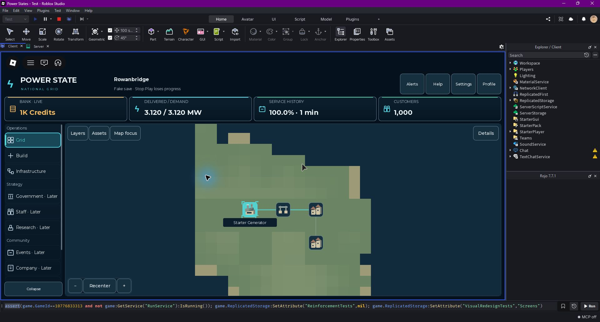 |
|  | 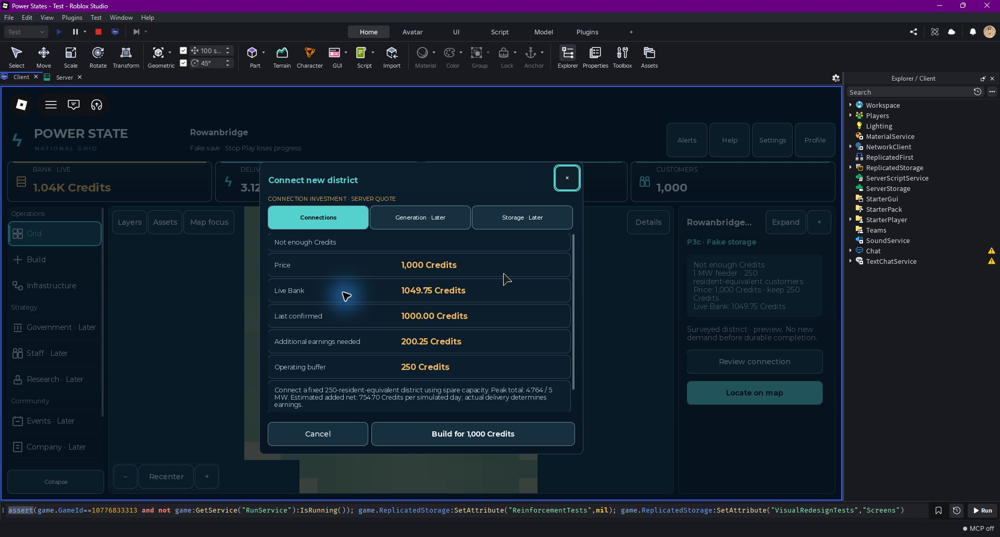 |
|  |  |

| Actual v1 before | Actual v1.1 after |
| --- | --- |
| 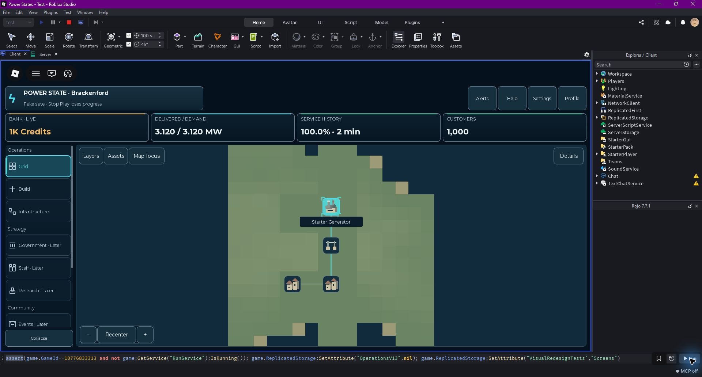 |  |
| 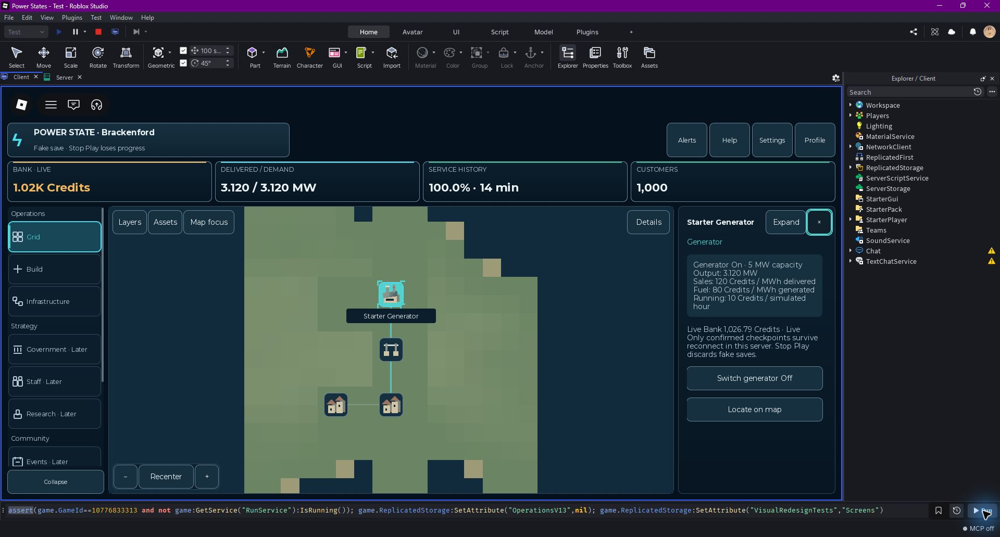 | 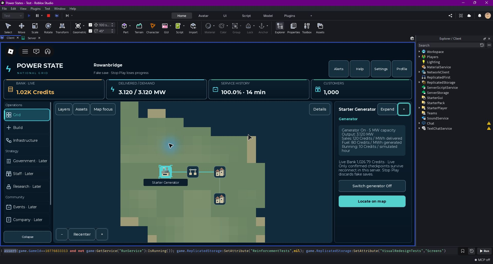 |
| 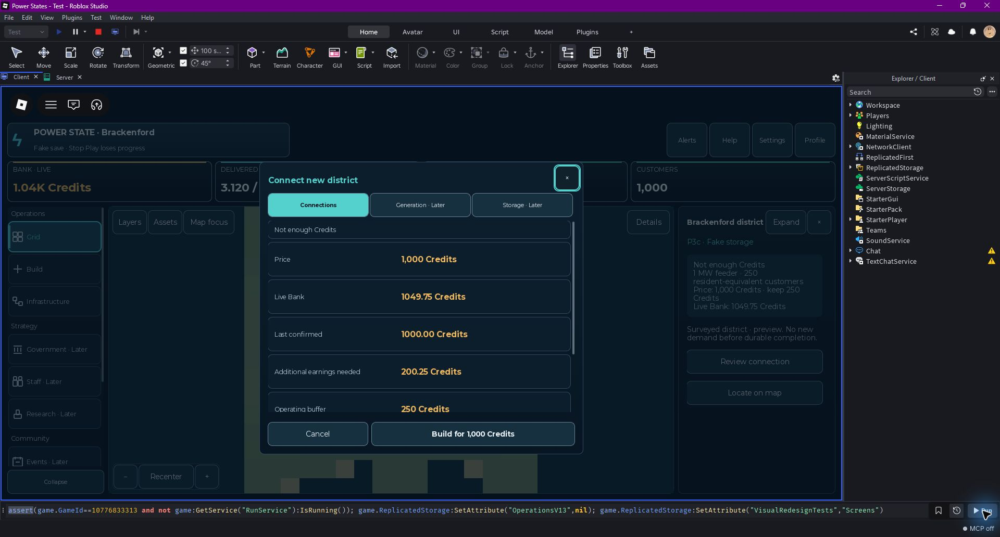 |  |
| 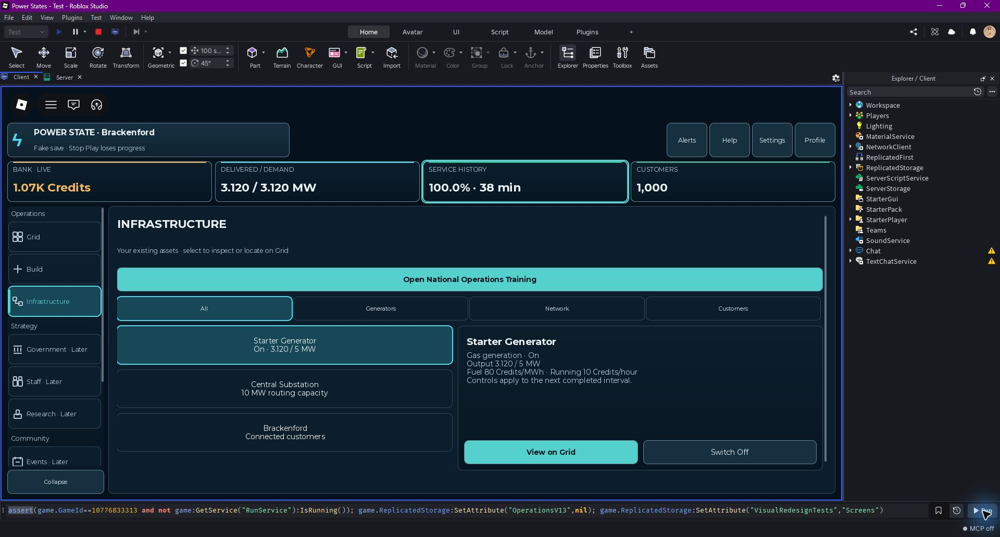 |  |
| 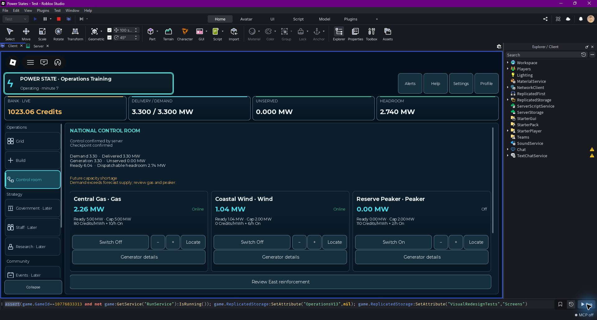 | 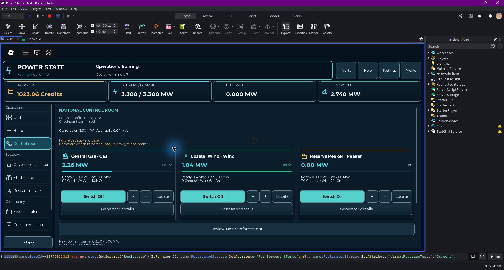 |
| 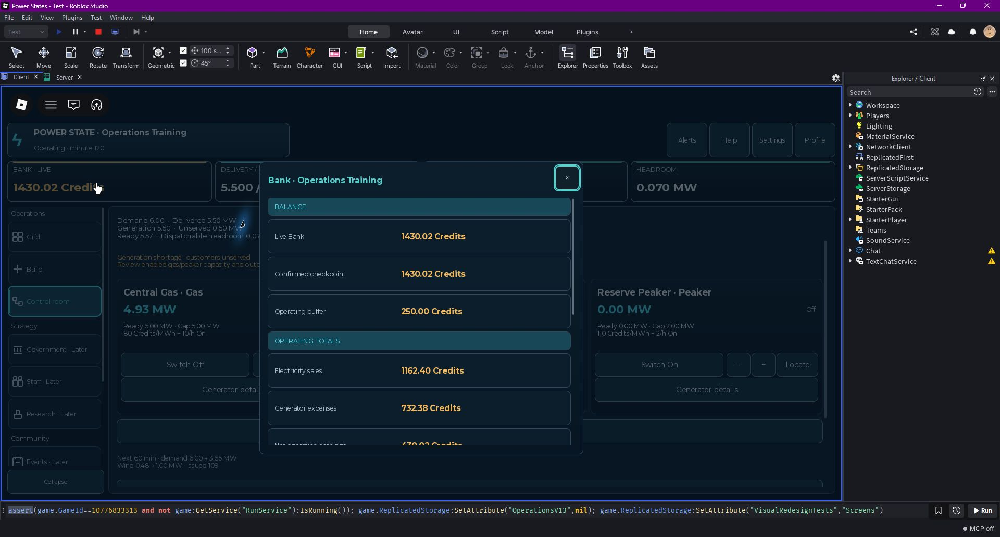 | 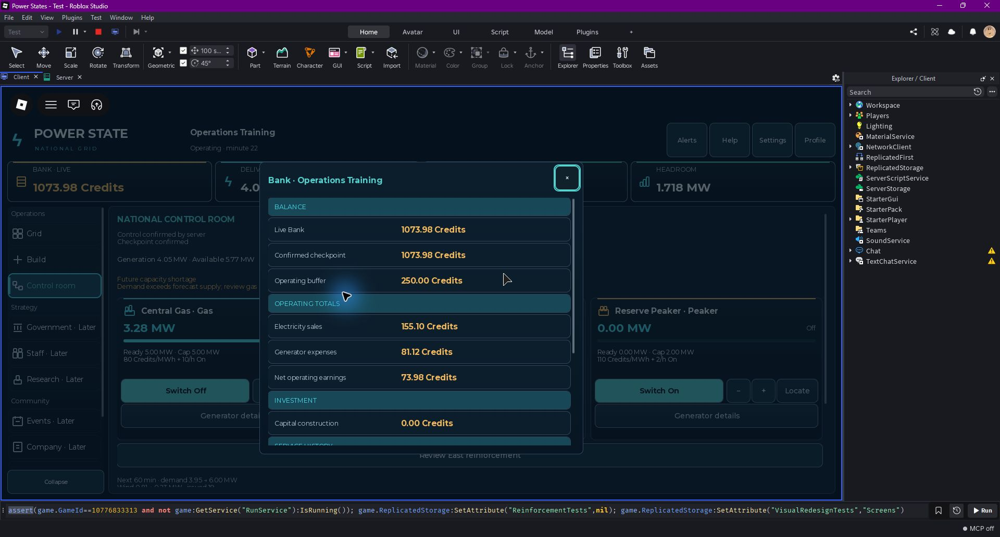 |
| 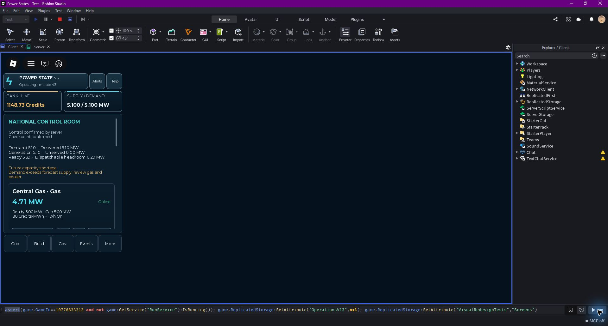 | 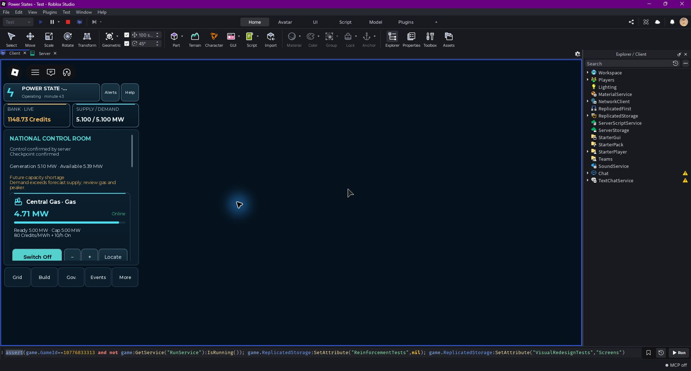 |
| 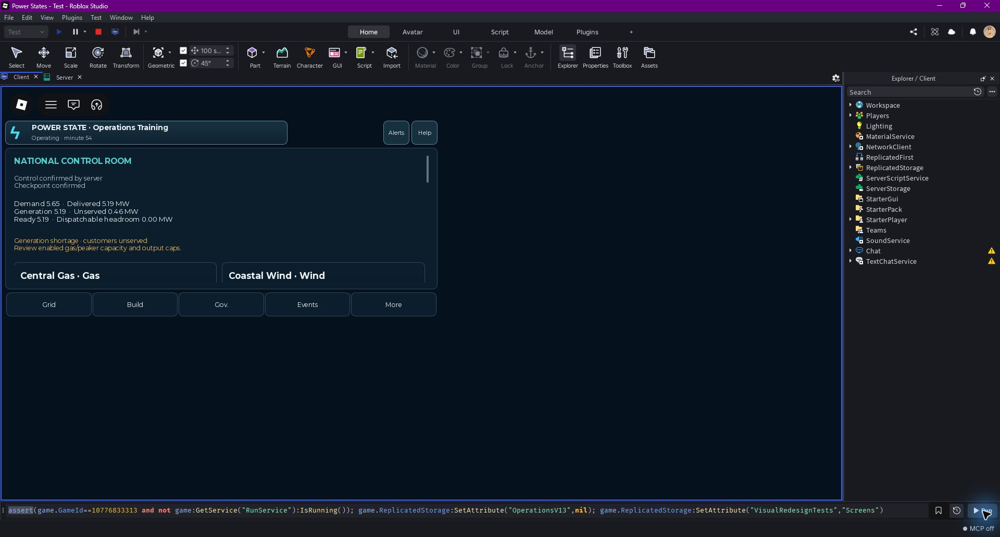 | 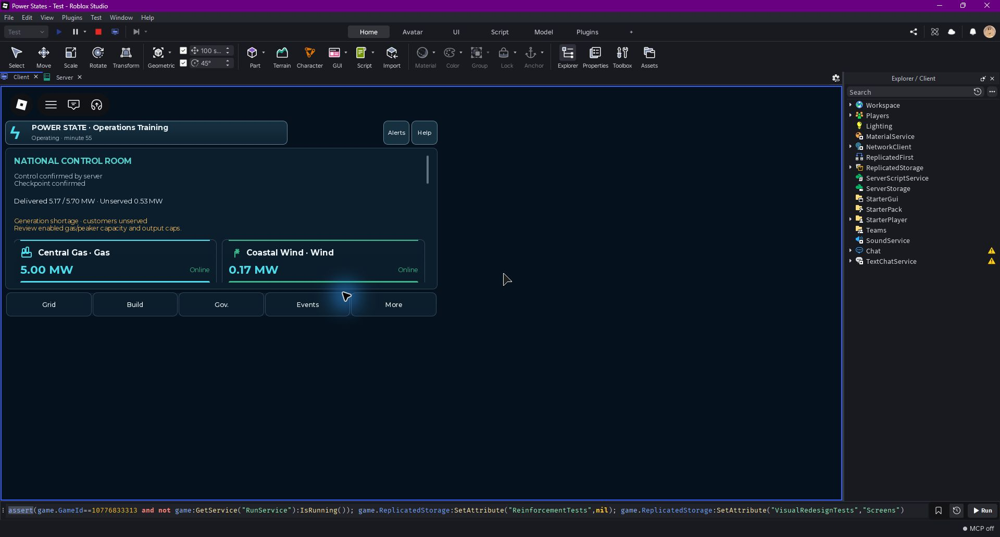 |

Additional captures: [First Playable Bank](evidence/visual-redesign-v11/bank-first-playable.png), [Grid tablet](evidence/visual-redesign-v11/grid-tablet.png), [Grid portrait](evidence/visual-redesign-v11/grid-portrait.png), [Grid landscape](evidence/visual-redesign-v11/grid-landscape.png), [reinforcement review](evidence/visual-redesign-v11/reinforcement-review.png).

Achieved: stronger separate branding/country hierarchy, compact rail, semantic KPIs, recognizable technology cards and actual-output bars, denser financial/project facts and primary-action contrast. Deliberate gaps: native block terrain, no asset photography/painted thumbnails, no Government/Staff/Shop/ticker implementation. Native icons are functional approximations rather than a complete illustrated icon family. Phone cards deliberately scroll; at short landscape the initial view does not show all generator controls simultaneously. Long compact identity text can truncate. These remain owner-review considerations, not claims of reference parity.

## Review setup and stop boundary

Open Power States - Test, connected to the existing Rojo Test server on port 34873, and press Play. Temporary acceptance runner flags were cleared and Play stopped after validation; ordinary fake-storage startup is retained. Review Grid, Build, Infrastructure and Bank; enter Operations Training for fleet controls and the reinforcement review. Stop Play discards fake progress. No real services, settings, uploads, publication or repository commits occurred. Physical touch/gamepad and owner visual acceptance remain outstanding. Stop here for owner review; no next gameplay phase is authorized.
